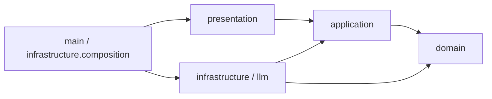
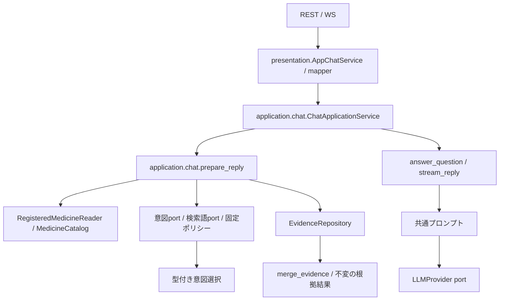

# バックエンドの構成と命名規則

このバックエンドは、**医薬品情報意思決定支援**という一つの業務ドメインを実装します。医薬品同定と添付文書根拠検索はそのサブドメインで、`application/chat` は両者を組み合わせる回答ユースケース、`presentation` はチャットを届ける配信層です。読み取り中心のため、会話集約、汎用Repository、Unit of Work、ドメインイベントは追加していません。Repository Interfaceは各 bounded context の `repositories.py` に定義し、PostgreSQL、SQLAlchemy Core、Alembicは外側の層に閉じ込めます。

## チャットの入出力上限

Vercel向けのNeon接続・10MiB XML分割取り込み・移行手順は[デプロイ準備](../docs/vercel-deployment.md)を参照してください。

RESTとWebSocketは重複のない対象YJコードを1～50件受け付けます。WebSocketは1回につき最大50メッセージ、各本文は最大4,000文字です。画面は会話全文を保持し、送信には直近24件の完了した往復と今回の質問を使います。失敗・中断・空の回答・4,000文字を超える本文がある往復は送信履歴から除外し、本文の途中切断は行いません。

起動時の環境設定は、既存のプロセス環境を優先します。未設定値だけをdotenvから補い、読み込むファイルはリポジトリルートの`.env.local`だけです。DB管理CLIも同じ設定を読み込みます。`PYTHON_DOTENV_DISABLED=1`ではファイルを読みません。

## 戦略設計上のドメイン境界

| 位置づけ | サブドメイン／層 | 業務上の責務 | 実装上の境界 |
| --- | --- | --- | --- |
| Core Subdomain | 問い合わせ解釈 | 質問意図を検索条件へ変換する | `domain/retrieval` |
| Core Subdomain | 添付文書根拠 | 出典付きの根拠を選び、文書単位の整合性を保持する | `domain/attachment` |
| Supporting Subdomain | 医薬品マスター | YJコードを識別子として医薬品コード対応表の10列を保持する | `domain/medicine` |
| Application | 回答準備・生成 | 2つのサブドメインとReader/Providerを順序付けて回答を作る | `application/chat` |
| Supporting Context | 知識取り込み・索引 | PMDA XMLを構造化し、検索可能な索引を作る | `application/attachment_import`、`infrastructure/pmda_xml`、`application/indexing` |
| Delivery / Generic | 対話配信 | REST/WebSocket、公開DTO、LLMストリームを提供する | `presentation`、`infrastructure/llm` |

`backend/domain` は一つのドメイン境界であり、bounded context ごとに純粋なモデルと規則を持ちます。`ChatMessage` や `ChatResponse` は回答ユースケースの入出力で、会話集約ではありません。会話履歴、権限、監査などに固有の業務規則が生じるまで、チャットを独立したドメインとして追加しません。

## 責務と配置

| 配置 | 責務 |
| --- | --- |
| `domain/attachment` | 添付文書 bounded context。`primitives.py`、`value_objects.py`、`entities.py`、`repositories.py`、`services.py`、`exceptions.py` に責務別の正本を置く |
| `domain/medicine` | 医薬品の名称・識別子・コード対応表、別名生成・照合優先度、照合結果を所有する |
| `domain/retrieval` | 検索 bounded context。検索Primitive、検索条件、意図選択、根拠・取得経路の統合、根拠取得ポート、検索ポリシーを置く |
| `domain/foundation` | 業務非依存のPrimitive、Value Object、Entity/Aggregate Rootの基底、宣言型ガード、例外基底 |
| `domain/shared` | 複数コンテキストで共有する汎用正規化処理を置く。YJコードはmedicineが所有する |
| `application/chat` | `ChatApplicationService` を中心に、会話から質問を取り出し、retrievalの結果を使って回答を準備・生成する。プロンプトと所有stream終了を担当する |
| `application/medicine` | 医薬品照合カタログ、文書参照との投影、フォームの医薬品候補提示（`MedicineSuggester.from_registered_medicines` による別名重み付け投影を含む）。候補提示は根拠検索に依存しない |
| `application/retrieval` | 質問とYJコードから医薬品を解決し、検索条件を生成して根拠を取得・統合する。WebSocketでは固定キーワード・形態素解析の各検出完了時にローカル根拠を累積配信し、Jev完了後に全検出条件の統合根拠で更新する。固定キーワードの配信は形態素解析を待たない。製品確認が必要な場合は先行配信しない。RESTと回答生成は全検出完了後の根拠を使う |
| `application/indexing` | 索引構築のユースケース・入出力契約 |
| `presentation` | Pydantic公開DTO、JSON変換、`AppChatService`（DTO変換アダプター）、REST/WSルーター、`dependencies.py`（全FastAPI `Depends` 関数の集約）。`domain` および `infrastructure` には一切依存しない |
| `infrastructure` | SDK JSON解釈、JSON読取、Janome、SQLAlchemy Reader/Writer、Alembic runner、共通payload変換（`index_payloads.py`、`evidence_mapping.py`） |
| `infrastructure/llm` | OpenAI/Gemini SDKと代替応答の実装 |
| `infrastructure/composition` / `main.py` | `app_lifespan.py`（`create_app_lifespan`）で具象の生成・接続・準備済みDB検証・SDK/worker/engineの所有終了を集約し、`main.py`（`create_app`）はCORS・ルーター登録とlifespan委譲のみを担当する |
| `config` | 接続設定と生成provider/modelの環境default供給 |
| `infrastructure/cli` | `manage_postgres`の明示migration/初期登録/export/rebuild/maintenance、`structure_pmda_xml`のoffline変換入口 |
| `infrastructure/package_insert_definitions` | 単一JSONのIO/検証と用途別組立、および各アダプター向け設定型（`definition_settings.py`）の所有。正式名称はattachment、検索規則・整形はretrieval、回答指示はApplicationが所有する |

公開DTOの`ChatMessage`/`ChatResponse`/`ChatSource`/`MedicineMatch`は`presentation`に置き、REST JSON・WSイベント・OpenAPIの名前を維持します。applicationの同名モデルはフレームワーク非依存の入出力です。`IntentResult.candidates`が意図判定の業務契約で、`raw_response`は公開原本として保持します。applicationはSDKの`answers`/`choice`/`probabilities`を読まず、presentation mapperが入力DTOからApplication入力への変換と、Application結果から公開JSONへの変換を担当します。準備済みの回答はApplicationモデルのまま生成まで保持し、出力DTOから内部モデルへ復元しません。

`Evidence`と医薬品の改訂情報は深い値として保持し、公開辞書は独立コピーにします。根拠集合はunit_idで最初に取得した内容を採用し、由来を統合して数値項目順に並べます。検出器の完了順に依存する既存の条件順・最初採用を維持します。PrimitiveやValue Objectの導入は既存の入力形式を狭めず、境界で受けた基本型を内部の明示的な型へ変換します。

医薬品候補の取得は `application/medicine/product_contracts.py` の `MedicineSnapshotProvider` を使い、同じ公開世代のIDと医薬品Readerだけを要求します。根拠検索側の `RetrievalSnapshotProvider` は根拠Readerも提供します。Infrastructureの世代runtimeは両契約を満たし、どちらも `acquire()` の終了まで同じ世代とleaseを保持します。

`infrastructure/sources` は明示した入力ファイルの読取を担当します。原本bytea・完全構造JSONB・検索投影の保存は `persistence/postgres_registration.py`、read-only MVCC読取は `persistence/postgres_runtime.py`、起動時のDB内整合性検証は `persistence/postgres_readiness.py` が担当します。persistenceはXML/source adapterへ依存せず、完全Domain構造は明示mapperで往復します。Composition RootがdecoderをImportServiceへ、encoderをpublisherへ注入し、engine/workersの寿命を所有します。

### 出力DTOの逆変換を防ぐ検査

`pnpm --filter backend lint`はRuff・Import Linterに加え、`lint:boundaries`でAST検査を実行します。Presentationの関数が出力専用の`ChatResponse`・`ChatSource`・`MedicineMatch`を引数に受け、Application型を返す、またはApplicationの型・関数を呼ぶ経路を禁止します。入力`ChatMessage`の変換、出力への変換、送信用callbackは許可します。

この検査は直接import・alias・修飾名・文字列型注釈・コレクション内の型を対象にします。`Any`や辞書に型を消した経路、動的import、別名の再代入を通じたデータフロー全体を証明するものではありません。型検査と、準備済みApplication結果の同一性・内部情報を保持するテストを併用します。

## リンターによるアーキテクチャ制約とドメイン基盤の利用

アーキテクチャ境界とレイヤー内モジュール階層は、`backend/pyproject.toml` の **Import Linter（全24契約）**、**Ruff（`TID251` 等の禁止API検査）**、および `backend/tests/architecture/test_architecture_dependencies.py` の **AST静的境界テスト** によって機械的に強制しています。
`pnpm --filter backend lint` はRuffとImport Linterを一括実行します（依存契約のみの検査は `pnpm --filter backend lint:imports`）。

### リンター駆動で実装を効率化する設計方針

1. **例外リスト（`ignore_imports`）に頼らない厳格・シンプルな境界**:
   - 「Presentation層からDomain層への一部のみ許可」のような例外運用は、Import Linterが間接推移依存（`Presentation -> Domain -> Domain内部`）まで遮断する性質上、例外リストの肥大化や判断の迷いを招きます。
   - そのため、**`Presentation does not depend on domain`（例外ゼロ）** のようにレイヤー間の禁止ルールを厳格・単純化し、ドメイン例外の変換や境界型の受け渡しはすべて `Application` 層で完結させています。
2. **レイヤー間の単方向依存（Onion Rings）**:
   - `Domain` は最内層として外部レイヤーに一切依存しません。
   - `Application` は `Domain` のみに依存します。
   - `Presentation` は `Application` と `Config` のみに依存します（`Domain`・`Infrastructure` への依存は完全禁止）。
   - `Infrastructure` は `Application`・`Domain`・`Config` に依存し、`Presentation` には依存しません（Composition Rootの配線のみ）。
3. **レイヤー内部のモジュール階層・独立性の強制**:
   - **Domain内部**: コンテキスト間（`attachment` / `medicine` / `retrieval`）は独立し、他コンテキストからは公開ID（`identifiers.py`）のみ参照可能です。さらにコンテキスト内部でも `identifiers -> exceptions -> primitives -> value_objects -> entities -> repositories -> services` の単方向階層を強制しています。
   - **Application内部**: `chat -> retrieval -> medicine` および `attachment_import -> indexing -> medicine` の有向パイプライン境界を強制し、逆方向参照や循環を防止します。
   - **Presentation内部**: `routes -> dependencies -> services (AppChatService) -> mappers -> DTO models` の5段階の階層を強制し、ルーターが `request.app.state` を直接読むことや、DTOモデルが上位サービスを参照することを防ぎます。
   - **Infrastructure内部**: 外部技術アダプター（`llm` / `intent` / `morphology` / `pmda_xml`）間の相互独立、`persistence -> sources` 禁止、`package_insert_definitions` から他アダプターへの依存禁止、`index_payloads` / `evidence_mapping` からアダプターパッケージへの依存禁止を契約化しています。

他コンテキストからの直接importは、所有元の `identifiers.py` に定義する公開ID Primitive（**1コンテキスト＝1公開ID**）に限ります。添付文書の `DocumentId` は `domain/attachment/identifiers.py`、検索単位の `SearchUnitId` は `domain/retrieval/identifiers.py`、医薬品の `YjCode` は `domain/medicine/identifiers.py` が正本です。それ以外の情報はApplicationで利用側の型へ変換します。
各コンテキストの `identifiers.py` のプロジェクト内import先は `domain/foundation/primitives/identifiers.py` だけです。標準ライブラリは利用でき、IDは `EntityUUID` または `EntityStringId` を継承します。文字列ID基底はNFKC正規化・前後の余白除去・空値拒否を行います。
sharedは各業務コンテキストへ、foundationは業務コンテキスト・sharedへ依存できません。
domain全体からapplication・infrastructure・presentationへの依存も禁止します。静的な直接・間接依存を検査し、動的importは対象外です。
`backend.domain.*` を独立性契約の対象とするため、新規コンテキストにも自動適用されます。公開IDとfoundation・sharedへの依存を許可し、共通基盤から業務コンテキストへの逆依存は禁止します。`identifiers.py` から内部モデルへの依存も禁止し、公開IDモジュールを迂回経路にしません。

`domain/foundation` は他のコンテキストに依存しません。単一値を包む新しい型は
`foundation.primitives.base.DomainPrimitive[T]` を継承し、`validate()` で制約を定義します。
文字列・数値も `DomainPrimitive` に統一します。共通基底は
`foundation.primitives.primitives` の `BaseString` / `BaseFiniteFloat` です。
比較は同じ具象Primitive同士で行い、文字列の検索・ソート・数値計算には `.value` を使います。
API・JSON・DB・プロンプトの境界でも `.value` へ変換します。
基本型との暗黙の比較や `asdict()` による公開JSON生成は行いません（Ruff `TID251` で `dataclasses.asdict` を禁止）。
`from_value()` は基本型から復元し、同じ具象型の不変Primitiveはそのまま受け取るため、
独自コンストラクタを持つモデルの `dataclasses.replace()` にも利用できます。
業務語彙（DocumentId、YjCode等）はsharedまたは対象コンテキストに置きます。

Entity / Value Object は型付け済みの値をコンストラクタへ渡して直接生成します。
引数の変換だけを行う `create()` は置かず（ASTテストで禁止）、入力を取り込む利用側でPrimitive・VO・
不変コレクションを組み立てます。単一値の制約はPrimitive、複数の値の関係や
集約内の整合性はモデルの生成時に検証します。

複合値は `@dataclass(frozen=True)` の不変オブジェクトとして定義します。
検索のSearchCriteria、IntentCandidate、IntentSelectionに加え、MedicineMatch、
添付文書の全Value Objectが不変な値として保持されます。
汎用JSON型の正本は `domain.foundation.json_types.JsonValue` です。
文字列基底 `BaseString` はNFKC正規化と前後の余白除去を行い、空文字を禁止します（DDDの原則に則り、プリミティブ文字列はそもそも空文字を許容せず不正な状態のインスタンスを作らせません。省略可能な概念は `Primitive | None` のように型として表現します）。
添付文書Primitiveは直接継承して固有の例外型・形式制約だけを追加します。
添付文書の文字列Primitiveと検索確率も共通生成処理から `validate()` を呼び、
各コンテキストの制約だけを追加します。Enumの正規化基底もfoundationに置きます。
コレクションを含むモデルは、不変なタプルとして保持します。


エンティティ（Medicine、SearchUnit等）は各コンテキストで固有の識別子・不変条件・
比較操作を持つドメインモデルとして定義します。
一意識別子には `EntityUUID`（Python 3.14の標準 `uuid.uuid7()` によるUUIDv7採番）や、
`EntityStringId` を利用できます。
backendの実行環境はPython 3.14以上が必要です。
`.python-version` は3.14を指定し、pnpmのbackendスクリプトも `uv run --locked` 経由で
この環境を利用します。初期同期は `uv sync --project backend --python 3.14 --locked`、
`pylock.toml` の再生成は
`uv export --project backend --format pylock.toml --output-file backend/pylock.toml --no-emit-project` です。

例外基底の正本は `foundation.exceptions` です。ドメインプリミティブやValue Objectの
制約違反はすべて `DomainValidationError` に統一され、添付文書例外（`AttachmentDomainError`）とともに `DomainError` として捕捉できます。
旧 `domain.shared.exceptions` の利用側は `domain.foundation.exceptions` に移行します。

## 依存関係と実行時の呼出し

`application/chat` は `ChatApplicationService` を通じて `application/retrieval.retrieve_evidence` を呼び、
チャットやLLMに依存しない `RetrievalResult` を受け取ります。
retrievalは会話メッセージ・回答生成・LLM Providerを参照しません。
この依存方向はImport Linterで間接依存も含めて検査します。
LLMによる回答生成の契約はchat、SDKの実装はInfrastructureが所有します。

次はimport依存の図です。矢印の先の型・契約を参照します。



`domain`から`application`、`presentation`、`infrastructure`、SDK、JSON loaderへの依存は禁止します。`application`は`domain`と標準ライブラリだけを参照します。`presentation`は`application`と`config`だけを参照し、`domain`・`infrastructure`への依存は全面禁止します。添付文書の正式名称はattachmentのSectionTaxonomyが所有し、Applicationのdefinition_projectionで用途側へ写します。検索規則/整形はretrieval、回答指示はApplication、JSON/XML/Jev/Janome設定はInfrastructure（`package_insert_definitions/definition_settings.py`）に置きます。永続化の具象IOは各 bounded context の `repositories.py` に定義したInterface越しに注入します。型確認用import・相対importも依存検査の対象です。

次は実行時の呼出しです。Reader/SDKは注入されたportの実装です。



確認応答ではprovider factoryを呼びません。環境defaultはconfigから供給し、呼出しで明示したprovider/modelを優先します。API・application・providerは所有するstreamを閉じます。lifespan（`infrastructure/composition/app_lifespan.py`）は所有Jev SDK、worker、engineを終了し、実行中のto_threadは強制停止せず完了を待ちます。

## ディレクトリ構成

```text
backend/
├── main.py / project_paths.py / alembic.ini
├── presentation/        # routes、dependencies、chat_service(DTO adapter)、mapper、公開DTO
├── application/
│   ├── chat/            # ChatApplicationService、prepare_reply、回答生成、prompt、stream終了
│   ├── medicine/        # 製品解決カタログ、フォームの候補提示(MedicineSuggester)
│   ├── retrieval/       # intent/keyword契約、条件生成、根拠取得ユースケース
│   ├── attachment_import/ # 添付文書取り込み・結果読取ユースケース
│   └── indexing/        # 索引構築契約とユースケース
├── domain/
│   ├── attachment/      # 添付文書 bounded context（責務別の直下モジュール）
│   ├── medicine/        # YJ医薬品マスター・別名優先度規則
│   ├── retrieval/       # 検索対象・条件・結果・根拠統合
│   ├── foundation/      # Primitive・不変Mapping・例外・JsonValueの共通基底
│   └── shared/          # 合意した共有語彙・純粋な文字列照合
├── infrastructure/
│   ├── intent/          # TypeSafe adapterと境界mapping
│   ├── morphology/      # Janome adapterとkeyword_extraction
│   ├── package_insert_definitions/ # 単一JSONカタログloaderと各adapter用definition_settings
│   ├── persistence/     # Core schema、Reader/Writer、GenerationRuntime、Publisher、workers
│   ├── pmda_xml/        # PMDA XML decoder / artifact encoder
│   ├── sources/         # FileIndexSourceReader、MedicineCodeTableReader
│   ├── llm/             # SDK provider / fallback
│   ├── composition/     # app_lifespan(DI配線)、index verifier、persistence lifespan
│   ├── cli/             # manage_postgres、structure_pmda_xml
│   ├── evidence_mapping.py
│   ├── index_payloads.py # XML非依存のJSON/検索単位payload変換
│   └── json_payloads.py
├── config/              # database_settings、generation_settings
├── migrations/          # env.pyとversions
└── tests/               # 現在形式の生成・保存・検索と未管理DB拒否を検証
```

旧`backend.chat`/`retrieval`/`medicines`/`storage`/`jev`とcompositionの旧サービス再公開は削除しました。ドメインモデルも責務別の正本へ統一し、既知のリポジトリ内利用側は正本へ移行しています。公開起動点は`backend.main:app`/`create_app`、既存REST/WSルート、FastAPI DI関数、用途別CLI moduleです。リポジトリ外の旧Python import利用は確認対象外です。

## 命名規則

ファイルは`snake_case`で責務を示し、クラスは`PascalCase`、関数は動詞を先頭にします。APIルートは`*_routes.py`、外部判定adapterは`*_detector.py`/`*_classifier.py`、純粋な業務判断は`*_policy.py`、外部表現の変換は`*_mapping.py`/`*_mapper.py`です。添付文書の編集規約は[Infrastructure定義ソース](infrastructure/package_insert_definitions/README.md)を参照します。組立束をサービスへ渡さず、用途別policy/settingsだけを注入します。公開APIのスキーマ・項目・ルート名は互換性を維持します。基本型を業務上の意味で包むものは`primitives`、同一性を持たない不変値は`value_objects`、同一性とライフサイクルを持つものは`entities`、複数モデルを組み合わせる処理は`services`へ置きます。

## データベース運用とマイグレーション

PostgreSQL 18、SQLAlchemy Core、Alembicを使用します。接続poolとworkerはlifespanが所有します。ローカルDockerの起動・owner/runtime権限分離は[root README](../README.md#ローカルpostgresqlの準備)を参照してください。

### マイグレーション手順

ownerのURLを`MEDI_CHAT_MIGRATION_DATABASE_URL`へ、アプリのDML用URLを`MEDI_CHAT_DATABASE_URL`へ設定します。URLの値をCLI引数やログへ出さず、環境変数名で対象を明示します。

```bash
pnpm db:migrate
pnpm db:initialize
```

初期登録は空の登録台帳だけを対象とし、既存DBを置換しません。旧SQLite/生成JSONLを読み戻す互換・移行・起動fallbackはありません。元XML/図を空PGへ再登録します。明示Alembic設定は`backend/postgres-alembic.ini`です。通常startup/publisherはDDLを実行しません。

### 検索インデックスの構築

原本からの新規登録はWebまたは次の明示CLIを使います。

```bash
uv run --project backend --locked python -m backend.infrastructure.cli.structure_pmda_xml new.xml --register --database-env MEDI_CHAT_DATABASE_URL
```

保持された完全Domain構造から投影を再構築する場合は`pnpm db:rebuild`（public schema）です。直接CLIを使う場合は`manage_postgres --database-env <owner URL変数名> --schema <対象schema> rebuild --confirm-schema <同じschema>`を明示します。原XMLの再decodeや入力ディレクトリ再走査は行いません。登録receipt・原本/図bytea・公開pointerを保持し、破損した原本/完全構造・確認不一致では書き込みません。

```bash
pnpm db:maintenance
pnpm db:export --version-id <document_id:sha256> --output-dir <新規出力先>
```

exportは原本byteaと図の元bytesを出力します。清掃は参照0payloadをDB transactionで回収し、receipt/tombstoneは残します。保存元ファイルや別schemaを削除する処理はありません。

### 添付文書データの再生成

`pnpm build:data`または`structure_pmda_xml --source-dir ... --output-dir ...`は確認用の純粋なoffline変換です。JSONLを生成してもPGへ公開登録しません。入力・出力の相対パスはリポジトリroot基準です。

## ポートとアダプターの拡張手順

新しい永続化ストレージ、検索検出器、LLMプロバイダーを追加する場合の手順：

1. **ポート（Protocol）の定義**:
   永続化・検索対象のRepository Interfaceは対象コンテキストの `backend/domain/<domain>/repositories.py` に、意図判定・キーワード抽出・LLMなどのユースケース用portは`backend/application/`にPython `typing.Protocol`で定義します。引数・戻り値は純粋なドメイン型または標準ライブラリ型にします。
2. **アダプターの実装**:
   `backend/infrastructure/` 配下に Protocol を満たす具象クラスを実装します。外部ライブラリへの依存はこのモジュール内に閉じ込めます。
3. **DIコンテナ / Lifespanへの配線**:
   `backend/infrastructure/composition/` 内で具象クラスを生成し、`backend/main.py` の Lifespan スコープまたは `backend/presentation/dependencies.py` の依存関数として登録します。
4. **テスト時のオーバーライド**:
   FastAPI の `app.dependency_overrides[get_chat_service] = ...` を使用して、テストダブル（Mock/Fake）を注入してテストします。

## 開発コマンド

DBは明示したPostgreSQL URLで選択します。CLIの入力・export出力の相対パスはリポジトリroot基準です。旧`MEDI_CHAT_STRUCTURED_DIR`/`MEDI_CHAT_INDEX_PATH`/`MEDI_CHAT_IMPORT_DIR`は拒否します。

リポジトリ直下で実行します。

```bash
# 依存関係のインストール
pnpm install

# 型チェック (Pyright) - 全ファイル 0 errors を維持
pnpm typecheck:python

# リンター & フォーマッター
uv run --project backend python -m ruff check backend
uv run --project backend python -m ruff format --check backend

# 全体テストスイートの実行
uv run --project backend pytest backend/tests

# 開発サーバー起動
pnpm dev:backend
```

### 医薬品と添付文書の責務

`medicine/entities.py` の `Medicine` は医薬品コード対応表の一製品を表し、YJコードを必須IDとします。
レセ電・一般名コード、名称2種類、一般名処方の標準的記載、適用・廃止日を保持します。
添付文書ID・URL・改訂情報や、文書から導出した成分IDを持ちません。
`MedicineCodeTableReader` はExcelの10列を読み、日付の `99999999` と任意欄の空値を `None` に変換します。
名称は原文を保持し、一般名処方の標準的記載を成分名として扱いません。
既存チャットの索引は引き続き添付文書掲載情報を使います。
`domain/medicine/entities.py` の `MedicineProduct` が医薬品名称・YJコードを保持し、
`domain/medicine/services.py` が別名生成・優先度選択を所有します。
照合用の `ProductGroupId` はmedicineが所有し、薬理学的な成分同一性を保証しません。
`MedicineMatch` は文書参照を含まない照合結果です。
attachmentは文書の原文表記・製品参照・構造・出典・改訂・登録を所有します。
`MedicineDocumentReference` が文書ID・URL・改訂を保持し、Applicationの
`RegisteredMedicine` が医薬品と文書参照を結びます。
`application/medicine/product_catalog.py` の `MedicineCatalog` がTrieとYJ索引を持ち、
medicineの規則を呼び出します。指定YJの優先と文書付き `ResolvedMedicine` の組立は
Applicationの責務です。YJ・一般名がない旧入力の文書IDによる区別もこの層に留めます。
DBとJSONの保存形式は維持し、Readerで明示的に両モデルへ変換します。
フォームの候補提示は `application/medicine/suggestions.py` の `MedicineSuggester` が担当します。
現在の候補データは添付文書掲載製品です。起動時に公開ID・名称・別名だけを
候補提示用の入力スナップショットへ変換し、添付文書モデルや根拠検索サービスを直接保持しません。
`MedicineCatalog` は回答準備の製品解決に限定し、フォームのサジェスト操作は持ちません。
医薬品マスターを候補データへ接続する処理は、今回追加していません。

モデル属性と公開JSONの文書識別子は `document_id`、複数形は `document_ids` に統一します。
既存DBの列と構造化JSONLの `document_key` は保存形式の契約として保持し、Infrastructureで変換します。

原本の識別・項目・製品・参照には `DocumentId`、`SectionCode`、
`AttachmentProductCode`、`AttachmentUrl` を使います。番号付き項目を扱う
原本モデルは `SectionCode.require_numbered()` で階層番号を検証します。
検索条件の項目コードはretrievalの `SearchSectionCode` を使います。
添付文書掲載製品の参照文字列と改訂情報はattachmentの `PmdaUrl` と
`AttachmentProductRevision` が所有します。
attachmentは原本文書の構造と整合性を所有し、Repositoryは文書取得だけを公開します。
原文から派生する `SearchUnit`、そのID・本文・種類・選択条件と検索処理はretrievalが所有します。
`SearchUnit` は索引で識別される検索前の本文単位Entityです。
`Evidence` は `retrieval/value_objects.py` の検索後の出典・取得経路付き結果VOで、
JSONLという保存形式には依存しません。根拠の重複排除・取得経路の統合は
`retrieval/services.py` の状態を持たない `merge_evidence()` が担当します。
最初の原文と既存の取得経路を保持し、経路を和集合で統合します。
番号付き項目・文字列項目・空項目の順に並べ、同項目では検索単位ID順の不変タプルを返します。
検索実行時の取得経路を表す
`DetectionSource` は `domain/retrieval/primitives.py` が所有します。

検索結果に載せる改訂・参照・項目・表の列のスナップショットはretrievalの
Value Objectとして保持します。検索ポートは文書IDを公開する入力契約を使います。
これらのMapping操作と入力・出力の独立コピーは、汎用基底の
`domain/foundation/value_objects.py` の `ImmutableMapping` に集約しています。
文書内の製品重複と項目の親子関係は `AttachmentDocument` が検証し、
取得経路は `frozenset[DetectionSource]` で保持し、公開JSONはEnum定義順の配列に変換します。
経路がない場合は空集合・空配列とし、組み合わせ専用のEnumや対応表は定義しません。

## XML取り込みの公開境界

`POST /api/attachment-imports`はmultipartの`file`1つを受け取り、`GET /api/attachment-imports/{document_id}/{source_sha256}`は保存結果metadataを返します。新規201・同原本200、入力数/空400、上限413、非XML415、構造/解析422、保存矛盾409、保存IO500。エラーは`detail: {code, message, phase}`で、409は`conflicts`も返します。

lifespanが取り込みworkerを所有し、decoderとpublisherをevent loop外で実行して終了を待ちます。原本/図bytea、完全構造JSONB、検索投影、active集合、世代pointer、receiptをPostgreSQLに保持します。`PostgresRegistrationPublisher`が一つのDB transactionで公開し、失敗時はrollbackします。新規201・同原本200、Location、エラーcode/message/phase/conflictsと削除済GET410を維持します。

YJごとに最も新しい改訂年月を選択し、同年月の別原本は409、年月なしは422です。A+Bの旧版に新Aが来た場合は旧Bを保持します。参照0payloadの削除失敗はDB由来reasonのcleanup_pendingになり、明示maintenance/登録後の限定再試行で回収します。再送はreceiptを再利用し、削除済み旧版の本文を復活させません。元XML・既存SQLite・手作業データは削除しません。

### 通常E2Eと索引の明示回復

`pnpm test:e2e`は通常dotenvで選択したPGをread-only readiness検査し、専用port3212の実OS health、その後mock/real Chromiumを順に実行します。`configured_e2e_gate --resolve-only`は秘密値を出しません。configured DBは書込/修復せず、未準備・実破損は拒否します。実接続試験は`TEST_DATABASE_URL`/`TEST_RUNTIME_DATABASE_URL`で明示した`medi_chat_test`の所有UUIDschemaだけを作成・削除します。既存serverや別runのschemaは停止・削除しません。

### 公開世代と取得の所有

製品解決・全detector・要求YJへの再投影・改訂materializeは、一つのread-only REPEATABLE READ接続でpointerを固定して行います。並行detectorが同じ接続を使う際はSQL利用を直列化します。別processが公開し旧payloadをDELETEしても、旧scopeはMVCCにより旧根拠を一貫して読み、次の要求だけが新版を使います。永久lease/PID/ファイルmanifestはありません。

例外・取消・切断・checkout待ちでも所有workerの完了とconnection返却を待ちます。LLM streamはmaterialize済みの不変な根拠だけを使い、DB接続を保持しません。poolとworkerの終了はcompositionが所有し、注入された外部engineを勝手に破棄しません。

startup/readinessはDDL・清掃・全原本decodeを行いません。DB内SHA256/サイズと完全構造・catalogue・投影の整合を検証し、Pythonへ原本/図を転送しません。JSON/projectionのMD5指紋は事故検出用です。整合した清掃待ちは起動でき、healthもDBを変更しません。Janomeは起動時にworker上で初期化します。

検索は1文字を無視し、2文字は再投影後のraw JSON文字列を照合します。3文字以上は正規化trigram phraseとBM25互換順位を使い、候補に件数LIMITやpg_trgm類似度閾値をかけません。要求内の文書ID/YJ集合ごとに投影を再利用し、scope終了時に破棄します。順位・Unicode・全表/出典は独立固定oracleで検証します。

### 改訂年月による公開先の選択

`AttachmentRegistration`、`RegistrationProposal`、`RegistrationReceipt` と登録台帳Repositoryは廃止しました。
`domain/attachment/services.py` の `latest_attachment()` は原本の改訂年月だけを比較します。
`registration_version()` は原本の改訂一覧から最も新しい年月を取得します。
同年月の別原本は版番号・ファイル名・登録順で決めず、明示的な競合とします。
ドメイン規則は医薬品情報を所有せず、文書版と改訂年月を扱います。

再送識別、公開受付番号、DB保持payload、MVCC snapshotとcleanupはInfrastructureが担当します。
古い原本の登録は保存結果を返しますが、検索対象の変更がなければ検索索引や世代は更新しません。
既存APIの保存結果の項目は維持します。

既存DBの公開先が改訂年月の最大値と一致しない、または最新年月の原本が曖昧な場合、
起動・読取検証と登録は `revision_policy_migration_required` で停止し、自動で参照先を書き換えません。
運用writer停止・backupと復元検査の上、原本を確認し、準備済みの別DBへ既存の
`manage_postgres initialize`（`pnpm db:initialize`）で明示的に初期登録して検証してください。
最も新しい原本がすでに削除されている場合は、原本の再取得が必要です。
同年月競合は原本の誤り・対象YJを確認して解消する必要があります。

### 検出の並行実行と先行根拠

WebSocketはJevの利用可否によらず、固定キーワード・形態素解析で取得した累積根拠を先行通知します。固定キーワード・形態素解析・Jevの3タスクを並行起動し、全検出と最終根拠の統合が完了した後にLLM生成へ進みます。Jev未接続時も分類タスクを実行し、利用不可の結果として完了します。製品同定に確認が必要な場合は先行根拠を公開せず、LLMを呼ばずに確認文を返します。

`retrieval_status.unavailable`はJevの利用不可を表し、ローカル検索や先行通知を無効化しません。Jev未接続時にも`sources`が複数回届くため、利用側は累積リストを置換し、最後の`sources`を最終結果として扱います。

## テストの配置

`tests/`は検証する契約の責務で分類します。セットアップでimportする層の数だけでは分類しません。

```text
tests/
├── domain/              # モデルの不変条件・照合・検索の純粋な規則
│   ├── attachment/
│   ├── foundation/
│   ├── medicine/
│   └── retrieval/
├── application/         # ユースケース・ポート・投影
│   ├── attachment_import/
│   ├── chat/
│   ├── indexing/
│   ├── medicine/
│   └── retrieval/
├── presentation/        # DTO変換・REST・WebSocketの公開契約
├── infrastructure/      # 永続化・XML・SDK・CLI・設定・入力ソース
├── integration/         # 起動・登録→検索・世代切替などの層横断契約
├── architecture/        # import・ASTによる責務と依存制約
├── support/             # 共有データ生成・子プロセス・旧形式の検証用実装
└── fixtures/            # 固定期待値と保全済みデータ
```

全体は`pnpm test:backend`、限定実行は例えば`uv run --project backend --locked pytest backend/tests/domain`や`uv run --project backend --locked pytest backend/tests/presentation`を使います。DTO逆変換の通常lintは`tests/architecture/test_architecture_dependencies.py`を参照します。

複数層の契約が同居する既存モジュールは、期待値やfixtureのスコープを変えずに`integration`へ配置しています。既存のテスト間importは新しい正本パスへ更新し、旧パスの再公開は残しません。新しく共通補助処理を増やす場合は`support`へ置きます。共有パスは`support/paths.py`から取得し、各テストのディレクトリ深度や実行時のcwdに依存させません。
