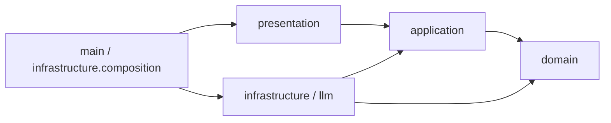
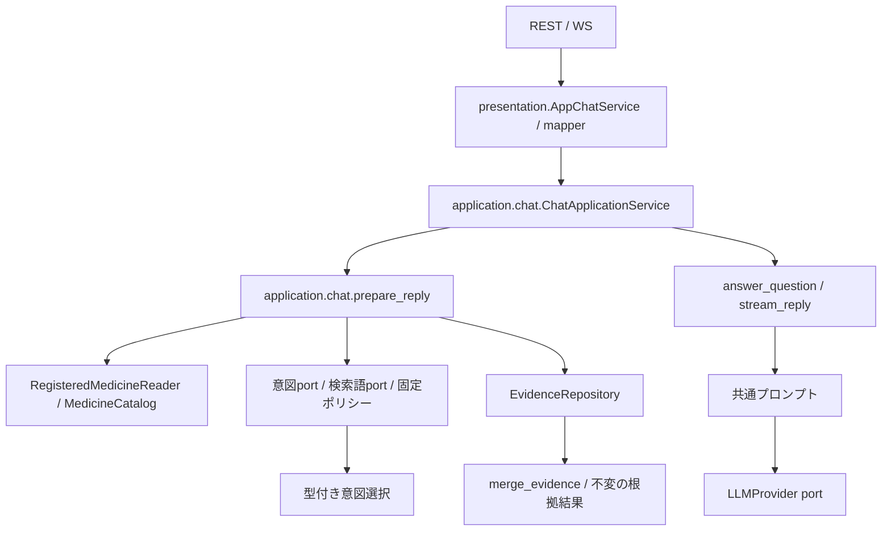

# バックエンドの構成と命名規則

このバックエンドは、**医薬品情報意思決定支援**という一つの業務ドメインを実装します。医薬品同定と添付文書根拠検索はそのサブドメインで、`application/chat` は両者を組み合わせる回答ユースケース、`presentation` はチャットを届ける配信層です。読み取り中心のため、会話集約、汎用Repository、Unit of Work、ドメインイベントは追加していません。Repository Interfaceは各 bounded context の `repositories.py` に定義し、SQLite、SQLAlchemy Core、Alembicは外側の層に閉じ込めます。

## 戦略設計上のドメイン境界

| 位置づけ | サブドメイン／層 | 業務上の責務 | 実装上の境界 |
| --- | --- | --- | --- |
| Core Subdomain | 問い合わせ解釈 | 質問意図を検索条件へ変換する | `domain/retrieval` |
| Core Subdomain | 添付文書根拠 | 出典付きの根拠を選び、文書単位の整合性を保持する | `domain/attachment` |
| Supporting Subdomain | 医薬品マスター | YJコードを識別子として医薬品コード対応表の10列を保持する | `domain/medicine` |
| Application | 回答準備・生成 | 2つのサブドメインとReader/Providerを順序付けて回答を作る | `application/chat` |
| Supporting Context | 知識取り込み・索引 | PMDA XMLを構造化し、検索可能な索引を作る | `application/attachment_import`、`infrastructure/pmda_xml`、`application/indexing` |
| Delivery / Generic | 対話配信 | REST/WebSocket、公開DTO、LLMストリームを提供する | `presentation`、`infrastructure/llm` |

`backend/domain` は一つのドメイン境界であり、bounded context ごとに純粋なモデルと規則を持ちます。`ChatMessage` や `ChatResponse` は回答ユースケースの入出力で、会話集約ではありません。会話履歴、権限、監査などに固有の業務規則が生じるまで、チャットを独立したドメインとして追加しません。

## 責務と配置

| 配置 | 責務 |
| --- | --- |
| `domain/attachment` | 添付文書 bounded context。`primitives.py`、`value_objects.py`、`entities.py`、`repositories.py`、`services.py`、`exceptions.py` に責務別の正本を置く |
| `domain/medicine` | 医薬品の名称・識別子・コード対応表、別名生成・照合優先度、照合結果を所有する |
| `domain/retrieval` | 検索 bounded context。検索Primitive、検索条件、意図選択、根拠・取得経路の統合、根拠取得ポート、検索ポリシーを置く |
| `domain/foundation` | 業務非依存のPrimitive、Value Object、Entity/Aggregate Rootの基底、宣言型ガード、例外基底 |
| `domain/shared` | 複数コンテキストで共有する汎用正規化処理を置く。YJコードはmedicineが所有する |
| `application/chat` | `ChatApplicationService` を中心に、会話から質問を取り出し、retrievalの結果を使って回答を準備・生成する。プロンプトと所有stream終了を担当する |
| `application/medicine` | 医薬品照合カタログ、文書参照との投影、フォームの医薬品候補提示（`MedicineSuggester.from_registered_medicines` による別名重み付け投影を含む）。候補提示は根拠検索に依存しない |
| `application/retrieval` | 質問とYJコードから医薬品を解決し、検索条件を生成して根拠を取得・統合する。WebSocketでは固定キーワード・形態素解析の各検出完了時にローカル根拠を累積配信し、Jev完了後に全検出条件の統合根拠で更新する。固定キーワードの配信は形態素解析を待たない。製品確認が必要な場合は先行配信しない。RESTと回答生成は全検出完了後の根拠を使う |
| `application/indexing` | 索引構築のユースケース・入出力契約 |
| `presentation` | Pydantic公開DTO、JSON変換、`AppChatService`（DTO変換アダプター）、REST/WSルーター、`dependencies.py`（全FastAPI `Depends` 関数の集約）。`domain` および `infrastructure` には一切依存しない |
| `infrastructure` | SDK JSON解釈、JSON読取、Janome、SQLAlchemy Reader/Writer、Alembic runner、旧v3検証・移行、共通payload変換（`index_payloads.py`、`evidence_mapping.py`） |
| `infrastructure/llm` | OpenAI/Gemini SDKと代替応答の実装 |
| `infrastructure/composition` / `main.py` | `app_lifespan.py`（`create_app_lifespan`）で具象の生成・接続・準備済みDB検証・SDK/worker/engineの所有終了を集約し、`main.py`（`create_app`）はCORS・ルーター登録とlifespan委譲のみを担当する |
| `config` | 接続設定と生成provider/modelの環境default供給 |
| `infrastructure/cli` | `build_search_index`、`migrate_legacy_index`の公開module入口 |
| `infrastructure/package_insert_definitions` | 単一JSONのIO/検証と用途別組立、および各アダプター向け設定型（`definition_settings.py`）の所有。正式名称はattachment、検索規則・整形はretrieval、回答指示はApplicationが所有する |

公開DTOの`ChatMessage`/`ChatResponse`/`ChatSource`/`MedicineMatch`は`presentation`に置き、REST JSON・WSイベント・OpenAPIの名前を維持します。applicationの同名モデルはフレームワーク非依存の入出力です。`IntentResult.candidates`が意図判定の業務契約で、`raw_response`は公開原本として保持します。applicationはSDKの`answers`/`choice`/`probabilities`を読まず、presentation mapperが公開JSONとの往復を担当します。

`Evidence`と医薬品の改訂情報は深い値として保持し、公開辞書は独立コピーにします。根拠集合はunit_idで最初に取得した内容を採用し、由来を統合して数値項目順に並べます。検出器の完了順に依存する既存の条件順・最初採用を維持します。PrimitiveやValue Objectの導入は既存の入力形式を狭めず、境界で受けた基本型を内部の明示的な型へ変換します。

医薬品候補の取得は `application/medicine/product_contracts.py` の `MedicineSnapshotProvider` を使い、同じ公開世代のIDと医薬品Readerだけを要求します。根拠検索側の `RetrievalSnapshotProvider` は根拠Readerも提供します。Infrastructureの世代runtimeは両契約を満たし、どちらも `acquire()` の終了まで同じ世代とleaseを保持します。

`infrastructure/sources` は入力ファイルの読取を担当します。登録原本の不変保存は `persistence/attachment_import_store.py`、公開済みDBと所有artifactの整合性検証・読取は `persistence/registration_reader.py` が担当し、persistenceからsourcesへは依存しません。また、JSON/検索単位payloadのシリアライズ（`index_payloads.py`）は `pmda_xml` から分離し、`GenerationRuntime` や `SqliteRegistrationPublisher` には `PmdaXmlDecoder` / `PmdaArtifactEncoder` をコンストラクタDIで注入します。

## リンターによるアーキテクチャ制約とドメイン基盤の利用

アーキテクチャ境界とレイヤー内モジュール階層は、`backend/pyproject.toml` の **Import Linter（全24契約）**、**Ruff（`TID251` 等の禁止API検査）**、および `backend/tests/test_architecture_dependencies.py` の **AST静的境界テスト** によって機械的に強制しています。
`pnpm --filter backend lint` はRuffとImport Linterを一括実行します（依存契約のみの検査は `pnpm --filter backend lint:imports`）。

### リンター駆動で実装を効率化する設計方針

1. **例外リスト（`ignore_imports`）に頼らない厳格・シンプルな境界**:
   - 「Presentation層からDomain層への一部のみ許可」のような例外運用は、Import Linterが間接推移依存（`Presentation -> Domain -> Domain内部`）まで遮断する性質上、例外リストの肥大化や判断の迷いを招きます。
   - そのため、**`Presentation does not depend on domain`（例外ゼロ）** のようにレイヤー間の禁止ルールを厳格・単純化し、ドメイン例外の変換や境界型の受け渡しはすべて `Application` 層で完結させています。
2. **レイヤー間の単方向依存（Onion Rings）**:
   - `Domain` は最内層として外部レイヤーに一切依存しません。
   - `Application` は `Domain` のみに依存します。
   - `Presentation` は `Application` と `Config` のみに依存します（`Domain`・`Infrastructure` への依存は完全禁止）。
   - `Infrastructure` は `Application`・`Domain`・`Config` に依存し、`Presentation` には依存しません（Composition Rootの配線のみ）。
3. **レイヤー内部のモジュール階層・独立性の強制**:
   - **Domain内部**: コンテキスト間（`attachment` / `medicine` / `retrieval`）は独立し、他コンテキストからは公開ID（`identifiers.py`）のみ参照可能です。さらにコンテキスト内部でも `identifiers -> exceptions -> primitives -> value_objects -> entities -> repositories -> services` の単方向階層を強制しています。
   - **Application内部**: `chat -> retrieval -> medicine` および `attachment_import -> indexing -> medicine` の有向パイプライン境界を強制し、逆方向参照や循環を防止します。
   - **Presentation内部**: `routes -> dependencies -> services (AppChatService) -> mappers -> DTO models` の5段階の階層を強制し、ルーターが `request.app.state` を直接読むことや、DTOモデルが上位サービスを参照することを防ぎます。
   - **Infrastructure内部**: 外部技術アダプター（`llm` / `intent` / `morphology` / `pmda_xml`）間の相互独立、`persistence -> sources` 禁止、`package_insert_definitions` から他アダプターへの依存禁止、`index_payloads` / `evidence_mapping` からアダプターパッケージへの依存禁止を契約化しています。

他コンテキストからの直接importは、所有元の `identifiers.py` に定義する公開ID Primitive（**1コンテキスト＝1公開ID**）に限ります。添付文書の `DocumentId` は `domain/attachment/identifiers.py`、検索単位の `SearchUnitId` は `domain/retrieval/identifiers.py`、医薬品の `YjCode` は `domain/medicine/identifiers.py` が正本です。それ以外の情報はApplicationで利用側の型へ変換します。
各コンテキストの `identifiers.py` のプロジェクト内import先は `domain/foundation/primitives/identifiers.py` だけです。標準ライブラリは利用でき、IDは `EntityUUID` または `EntityStringId` を継承します。文字列ID基底はNFKC正規化・前後の余白除去・空値拒否を行います。
sharedは各業務コンテキストへ、foundationは業務コンテキスト・sharedへ依存できません。
domain全体からapplication・infrastructure・presentationへの依存も禁止します。静的な直接・間接依存を検査し、動的importは対象外です。
`backend.domain.*` を独立性契約の対象とするため、新規コンテキストにも自動適用されます。公開IDとfoundation・sharedへの依存を許可し、共通基盤から業務コンテキストへの逆依存は禁止します。`identifiers.py` から内部モデルへの依存も禁止し、公開IDモジュールを迂回経路にしません。

`domain/foundation` は他のコンテキストに依存しません。単一値を包む新しい型は
`foundation.primitives.base.DomainPrimitive[T]` を継承し、`validate()` で制約を定義します。
文字列・数値も `DomainPrimitive` に統一します。共通基底は
`foundation.primitives.primitives` の `BaseString` / `BaseFiniteFloat` です。
比較は同じ具象Primitive同士で行い、文字列の検索・ソート・数値計算には `.value` を使います。
API・JSON・SQLite・プロンプトの境界でも `.value` へ変換します。
基本型との暗黙の比較や `asdict()` による公開JSON生成は行いません（Ruff `TID251` で `dataclasses.asdict` を禁止）。
`from_value()` は基本型から復元し、同じ具象型の不変Primitiveはそのまま受け取るため、
独自コンストラクタを持つモデルの `dataclasses.replace()` にも利用できます。
業務語彙（DocumentId、YjCode等）はsharedまたは対象コンテキストに置きます。

Entity / Value Object は型付け済みの値をコンストラクタへ渡して直接生成します。
引数の変換だけを行う `create()` は置かず（ASTテストで禁止）、入力を取り込む利用側でPrimitive・VO・
不変コレクションを組み立てます。単一値の制約はPrimitive、複数の値の関係や
集約内の整合性はモデルの生成時に検証します。

複合値は `@dataclass(frozen=True)` の不変オブジェクトとして定義します。
検索のSearchCriteria、IntentCandidate、IntentSelectionに加え、MedicineMatch、
添付文書の全Value Objectが不変な値として保持されます。
汎用JSON型の正本は `domain.foundation.json_types.JsonValue` です。
文字列基底 `BaseString` はNFKC正規化と前後の余白除去を行い、空文字を禁止します（DDDの原則に則り、プリミティブ文字列はそもそも空文字を許容せず不正な状態のインスタンスを作らせません。省略可能な概念は `Primitive | None` のように型として表現します）。
添付文書Primitiveは直接継承して固有の例外型・形式制約だけを追加します。
添付文書の文字列Primitiveと検索確率も共通生成処理から `validate()` を呼び、
各コンテキストの制約だけを追加します。Enumの正規化基底もfoundationに置きます。
コレクションを含むモデルは、不変なタプルとして保持します。


エンティティ（Medicine、SearchUnit等）は各コンテキストで固有の識別子・不変条件・
比較操作を持つドメインモデルとして定義します。
一意識別子には `EntityUUID`（Python 3.14の標準 `uuid.uuid7()` によるUUIDv7採番）や、
`EntityStringId` を利用できます。
backendの実行環境はPython 3.14以上が必要です。
`.python-version` は3.14を指定し、pnpmのbackendスクリプトも `uv run --locked` 経由で
この環境を利用します。初期同期は `uv sync --project backend --python 3.14 --locked`、
`pylock.toml` の再生成は
`uv export --project backend --format pylock.toml --output-file backend/pylock.toml --no-emit-project` です。

例外基底の正本は `foundation.exceptions` です。ドメインプリミティブやValue Objectの
制約違反はすべて `DomainValidationError` に統一され、添付文書例外（`AttachmentDomainError`）とともに `DomainError` として捕捉できます。
旧 `domain.shared.exceptions` の利用側は `domain.foundation.exceptions` に移行します。

## 依存関係と実行時の呼出し

`application/chat` は `ChatApplicationService` を通じて `application/retrieval.retrieve_evidence` を呼び、
チャットやLLMに依存しない `RetrievalResult` を受け取ります。
retrievalは会話メッセージ・回答生成・LLM Providerを参照しません。
この依存方向はImport Linterで間接依存も含めて検査します。
LLMによる回答生成の契約はchat、SDKの実装はInfrastructureが所有します。

次はimport依存の図です。矢印の先の型・契約を参照します。



`domain`から`application`、`presentation`、`infrastructure`、SDK、JSON loaderへの依存は禁止します。`application`は`domain`と標準ライブラリだけを参照します。`presentation`は`application`と`config`だけを参照し、`domain`・`infrastructure`への依存は全面禁止します。添付文書の正式名称はattachmentのSectionTaxonomyが所有し、Applicationのdefinition_projectionで用途側へ写します。検索規則/整形はretrieval、回答指示はApplication、JSON/XML/Jev/Janome設定はInfrastructure（`package_insert_definitions/definition_settings.py`）に置きます。永続化の具象IOは各 bounded context の `repositories.py` に定義したInterface越しに注入します。型確認用import・相対importも依存検査の対象です。

次は実行時の呼出しです。Reader/SDKは注入されたportの実装です。



確認応答ではprovider factoryを呼びません。環境defaultはconfigから供給し、呼出しで明示したprovider/modelを優先します。API・application・providerは所有するstreamを閉じます。lifespan（`infrastructure/composition/app_lifespan.py`）は所有Jev SDK、worker、engineを終了し、実行中のto_threadは強制停止せず完了を待ちます。

## ディレクトリ構成

```text
backend/
├── main.py / project_paths.py / alembic.ini
├── presentation/        # routes、dependencies、chat_service(DTO adapter)、mapper、公開DTO
├── application/
│   ├── chat/            # ChatApplicationService、prepare_reply、回答生成、prompt、stream終了
│   ├── medicine/        # 製品解決カタログ、フォームの候補提示(MedicineSuggester)
│   ├── retrieval/       # intent/keyword契約、条件生成、根拠取得ユースケース
│   ├── attachment_import/ # 添付文書取り込み・結果読取ユースケース
│   └── indexing/        # 索引構築契約とユースケース
├── domain/
│   ├── attachment/      # 添付文書 bounded context（責務別の直下モジュール）
│   ├── medicine/        # YJ医薬品マスター・別名優先度規則
│   ├── retrieval/       # 検索対象・条件・結果・根拠統合
│   ├── foundation/      # Primitive・不変Mapping・例外・JsonValueの共通基底
│   └── shared/          # 合意した共有語彙・純粋な文字列照合
├── infrastructure/
│   ├── intent/          # TypeSafe adapterと境界mapping
│   ├── morphology/      # Janome adapterとkeyword_extraction
│   ├── package_insert_definitions/ # 単一JSONカタログloaderと各adapter用definition_settings
│   ├── persistence/     # Core schema、Reader/Writer、GenerationRuntime、Publisher、workers
│   ├── pmda_xml/        # PMDA XML decoder / artifact encoder
│   ├── sources/         # FileIndexSourceReader、MedicineCodeTableReader
│   ├── llm/             # SDK provider / fallback
│   ├── composition/     # app_lifespan(DI配線)、index verifier、persistence lifespan
│   ├── cli/             # build_search_index、migrate_legacy_index、initialize_registrations
│   ├── evidence_mapping.py
│   ├── index_payloads.py # XML非依存のJSON/検索単位payload変換
│   └── json_payloads.py
├── config/              # database_settings、generation_settings
├── migrations/          # env.pyとversions
└── tests/               # legacy_v3は未管理旧形式DBの生成専用Fixture
```

旧`backend.chat`/`retrieval`/`medicines`/`storage`/`jev`とcompositionの旧サービス再公開は削除しました。ドメインモデルも責務別の正本へ統一し、既知のリポジトリ内利用側は正本へ移行しています。公開起動点は`backend.main:app`/`create_app`、既存REST/WSルート、FastAPI DI関数、6つのCLI moduleです。リポジトリ外の旧Python import利用は確認対象外です。

## 命名規則

ファイルは`snake_case`で責務を示し、クラスは`PascalCase`、関数は動詞を先頭にします。APIルートは`*_routes.py`、外部判定adapterは`*_detector.py`/`*_classifier.py`、純粋な業務判断は`*_policy.py`、外部表現の変換は`*_mapping.py`/`*_mapper.py`です。添付文書の編集規約は[Infrastructure定義ソース](infrastructure/package_insert_definitions/README.md)を参照します。組立束をサービスへ渡さず、用途別policy/settingsだけを注入します。公開APIのスキーマ・項目・ルート名は互換性を維持します。基本型を業務上の意味で包むものは`primitives`、同一性を持たない不変値は`value_objects`、同一性とライフサイクルを持つものは`entities`、複数モデルを組み合わせる処理は`services`へ置きます。

## データベース運用とマイグレーション

データベースには SQLite（FTS5全文検索対応）を使用し、スキーマ管理には **Alembic**、クエリ実行には **SQLAlchemy Core** を採用しています。

### マイグレーション手順

```bash
# 最新スキーマへのアップグレード
uv run --project backend alembic -c backend/alembic.ini upgrade head

# ベース状態（全テーブル削除）へのダウングレード
uv run --project backend alembic -c backend/alembic.ini downgrade base
```

### 検索インデックスの構築

登録済みactive集合を検証します。旧ディレクトリを走査して旧版を再登録しません。
旧索引は利用中writerを停止し、整合backup・復元検査後に明示Alembicと初期登録を行ってください。
起動時にschema作成や初期登録は行いません。まずコピー先で照合してください。

```bash
uv run --project backend alembic -c backend/alembic.ini -x index_path=copy/index.sqlite3 upgrade head
uv run --project backend python -m backend.infrastructure.cli.initialize_registrations \
  --originals-dir copy/originals --structured-dir copy/structured \
  --index-path copy/index.sqlite3 --import-dir copy/imports
```

既存変換CLIの引数と厳格な図検査は維持しています。通常modeはoffline変換で公開登録しません。
登録済み所有artifactへの直接上書きは拒否します。`--register`を明示するとWebと同じpublisherで
登録します（`--output-dir`は純変換専用）。`build:data`はこの登録modeを利用します。

```bash
uv run --project backend python -m backend.infrastructure.cli.structure_pmda_xml \
  copy/new.xml --register --index-path copy/index.sqlite3 --import-dir copy/imports
```

```bash
# 既定のパス (data/pmda/structured/ -> .chat-search.sqlite3) でインデックス構築
uv run --project backend python -m backend.infrastructure.cli.build_search_index

# 任意のパスを指定して実行
uv run --project backend python -m backend.infrastructure.cli.build_search_index \
  --structured-dir data/pmda/structured \
  --index-path data/pmda/structured/.chat-search.sqlite3
```

### 未管理旧v3 SQLiteデータベースの移行

過去の自動構築スクリプト等で作成された未管理の旧v3データベースは、専用の移行コマンドで安全に別ファイルへ複製・検証・Alembic管理化します：

```bash
uv run --project backend python -m backend.infrastructure.cli.migrate_legacy_index \
  --source-index data/pmda/structured/old-index.sqlite3 \
  --output-index data/pmda/structured/.chat-search.sqlite3
```
- 元データベースの整合性を検証（PRAGMA integrity_check、JSONスキーマ、FTS5整合性）
- SQLite Online Backup API を用いて安全に整合複製（WALコミット済みデータも完全に反映）
- 複製先のみに対して Alembic stamp（`0001_v3_schema`）と upgrade を適用
- 移行前後の全レコード数・代表検索結果・指紋の完全一致を自動検証

## ポートとアダプターの拡張手順

新しい永続化ストレージ、検索検出器、LLMプロバイダーを追加する場合の手順：

1. **ポート（Protocol）の定義**:
   永続化・検索対象のRepository Interfaceは対象コンテキストの `backend/domain/<domain>/repositories.py` に、意図判定・キーワード抽出・LLMなどのユースケース用portは`backend/application/`にPython `typing.Protocol`で定義します。引数・戻り値は純粋なドメイン型または標準ライブラリ型にします。
2. **アダプターの実装**:
   `backend/infrastructure/` 配下に Protocol を満たす具象クラスを実装します。外部ライブラリへの依存はこのモジュール内に閉じ込めます。
3. **DIコンテナ / Lifespanへの配線**:
   `backend/infrastructure/composition/` 内で具象クラスを生成し、`backend/main.py` の Lifespan スコープまたは `backend/presentation/dependencies.py` の依存関数として登録します。
4. **テスト時のオーバーライド**:
   FastAPI の `app.dependency_overrides[get_chat_service] = ...` を使用して、テストダブル（Mock/Fake）を注入してテストします。

## 開発コマンド

DB設定・CLIに渡す相対パス（`MEDI_CHAT_STRUCTURED_DIR`、
`MEDI_CHAT_INDEX_PATH`、SQLite URLの相対DBパスを含む）は、
実行ディレクトリではなくリポジトリルートを基準に解決します。
絶対パスの明示指定も利用できます。実行時にはDB接続用に絶対パスへ解決します。

リポジトリ直下で実行します。

```bash
# 依存関係のインストール
pnpm install

# 型チェック (Pyright) - 全ファイル 0 errors を維持
pnpm typecheck:python

# リンター & フォーマッター
uv run --project backend python -m ruff check backend
uv run --project backend python -m ruff format --check backend

# 全体テストスイートの実行
uv run --project backend pytest backend/tests

# 開発サーバー起動
pnpm dev:backend
```

### 医薬品と添付文書の責務

`medicine/entities.py` の `Medicine` は医薬品コード対応表の一製品を表し、YJコードを必須IDとします。
レセ電・一般名コード、名称2種類、一般名処方の標準的記載、適用・廃止日を保持します。
添付文書ID・URL・改訂情報や、文書から導出した成分IDを持ちません。
`MedicineCodeTableReader` はExcelの10列を読み、日付の `99999999` と任意欄の空値を `None` に変換します。
名称は原文を保持し、一般名処方の標準的記載を成分名として扱いません。
既存チャットの索引は引き続き添付文書掲載情報を使います。
`domain/medicine/entities.py` の `MedicineProduct` が医薬品名称・YJコードを保持し、
`domain/medicine/services.py` が別名生成・優先度選択を所有します。
照合用の `ProductGroupId` はmedicineが所有し、薬理学的な成分同一性を保証しません。
`MedicineMatch` は文書参照を含まない照合結果です。
attachmentは文書の原文表記・製品参照・構造・出典・改訂・登録を所有します。
`MedicineDocumentReference` が文書ID・URL・改訂を保持し、Applicationの
`RegisteredMedicine` が医薬品と文書参照を結びます。
`application/medicine/product_catalog.py` の `MedicineCatalog` がTrieとYJ索引を持ち、
medicineの規則を呼び出します。指定YJの優先と文書付き `ResolvedMedicine` の組立は
Applicationの責務です。YJ・一般名がない旧入力の文書IDによる区別もこの層に留めます。
DBとJSONの保存形式は維持し、Readerで明示的に両モデルへ変換します。
フォームの候補提示は `application/medicine/suggestions.py` の `MedicineSuggester` が担当します。
現在の候補データは添付文書掲載製品です。起動時に公開ID・名称・別名だけを
候補提示用の入力スナップショットへ変換し、添付文書モデルや根拠検索サービスを直接保持しません。
`MedicineCatalog` は回答準備の製品解決に限定し、フォームのサジェスト操作は持ちません。
医薬品マスターを候補データへ接続する処理は、今回追加していません。

モデル属性と公開JSONの文書識別子は `document_id`、複数形は `document_ids` に統一します。
既存DBの列と構造化JSONLの `document_key` は保存形式の契約として保持し、Infrastructureで変換します。

原本の識別・項目・製品・参照には `DocumentId`、`SectionCode`、
`AttachmentProductCode`、`AttachmentUrl` を使います。番号付き項目を扱う
原本モデルは `SectionCode.require_numbered()` で階層番号を検証します。
検索条件の項目コードはretrievalの `SearchSectionCode` を使います。
添付文書掲載製品の参照文字列と改訂情報はattachmentの `PmdaUrl` と
`AttachmentProductRevision` が所有します。
attachmentは原本文書の構造と整合性を所有し、Repositoryは文書取得だけを公開します。
原文から派生する `SearchUnit`、そのID・本文・種類・選択条件と検索処理はretrievalが所有します。
`SearchUnit` は索引で識別される検索前の本文単位Entityです。
`Evidence` は `retrieval/value_objects.py` の検索後の出典・取得経路付き結果VOで、
JSONLという保存形式には依存しません。根拠の重複排除・取得経路の統合は
`retrieval/services.py` の状態を持たない `merge_evidence()` が担当します。
最初の原文と既存の取得経路を保持し、経路を和集合で統合します。
番号付き項目・文字列項目・空項目の順に並べ、同項目では検索単位ID順の不変タプルを返します。
検索実行時の取得経路を表す
`DetectionSource` は `domain/retrieval/primitives.py` が所有します。

検索結果に載せる改訂・参照・項目・表の列のスナップショットはretrievalの
Value Objectとして保持します。検索ポートは文書IDを公開する入力契約を使います。
これらのMapping操作と入力・出力の独立コピーは、汎用基底の
`domain/foundation/value_objects.py` の `ImmutableMapping` に集約しています。
文書内の製品重複と項目の親子関係は `AttachmentDocument` が検証し、
取得経路は `frozenset[DetectionSource]` で保持し、公開JSONはEnum定義順の配列に変換します。
経路がない場合は空集合・空配列とし、組み合わせ専用のEnumや対応表は定義しません。

## XML取り込みの公開境界

`POST /api/attachment-imports`はmultipartの`file`1つを受け取り、`GET /api/attachment-imports/{document_id}/{source_sha256}`は保存結果metadataを返します。新規201・同原本200、入力数/空400、上限413、非XML415、構造/解析422、保存矛盾409、保存IO500。新APIのエラーは`detail: {code, message}`です。

lifespanが取り込みworkerを所有し、decoder/encoder/保存IOをevent loop外で実行して終了を待ちます。既定保存先は`data/pmda/imports`、環境変数は`MEDI_CHAT_IMPORT_DIR`です。Alembic移行と初期登録済みの検索DBが起動前提です。既存DBはwriter停止・整合backup・コピー復元検査後、上記「検索インデックスの構築」の明示手順で移行してください。起動時に自動DDL・初期登録はしません。

Web取り込みは保存だけでなく、`SqliteRegistrationPublisher`でactive製品・検索本文・候補・fingerprintを同一SQLite transactionで公開します。旧structured/manifestは直接上書きせず、import rootに版と世代成果物を保存します。YJごとに原本の改訂年月（YYYY-MM）が最も新しい添付文書を採用し、旧文書の未置換YJは保持します。古い原本を後から登録しても公開先・検索世代を戻しません。同じ改訂年月の別原本が同じYJに対応する場合は409（same_revision_conflict）、改訂年月がない場合は422（missing_revision）で拒否します。初期登録CLIも同じ規則を使います。active参照とreader leaseがない旧版の所有ファイルだけを削除し、削除待ちは再試行します。同原本の再送は保存済みreceiptを再利用し、旧版を復活させません。登録順は公開結果の受付番号としてのみ保持します。登録に利用できるYJがないXMLは422で拒否します。原本/保存絶対パスの公開APIは追加していません。

### 通常E2Eと索引の明示回復

`pnpm test:e2e`は通常devと同じdotenv読み込み・DB設定解決を使い、read-only readinessと通常mainの内部read-only probe compositionによる実OS healthを確認してから画面suiteへ進みます。`uv run --project backend --locked python -m backend.infrastructure.cli.configured_e2e_gate --resolve-only`で秘密値を出さず絶対source/indexを確認できます。未準備・staleでは非0で止まり、起動時の自動build/migrateは行いません。

運用索引の再構築は対象の絶対source/indexを明示し、その対象を利用するbackend/writerを利用者が停止した後に行います。試験から既存serverを停止しません。Windowsでは`infrastructure.cli.index_maintenance.assert_stopped`がDBと存在するWAL/SHMの排他可否を検査します。`checked_backup(target, backup)`でmanaged schema・integrity・全テーブルの論理内容・保存fingerprintを照合したread-only SQLite backupを作成し、別一時DBへ復元して同じ論理snapshotであることを確認します。backupは保存し、`verify_rebuild_preconditions(target, backup)`成立後、既存`build_search_index` moduleへ絶対source/indexを渡して明示再構築してください。対象未明示・backup未確認・open writer・unmanaged schemaでは更新せず、必要な停止/backup/migration判断へ戻します。

再構築後はsource/index/fingerprint/件数/前後hashと実healthを記録します。原XML・図・document.json・search_units.jsonl・manifest・旧保全物を再生成しません。登録済みモデルではWeb登録と明示登録CLIが同じpublisherを使い、active製品・検索本文・候補・fingerprintを一つのSQLite transactionで公開します。純粋なoffline変換は公開登録ではありません。

### 公開世代と取得の所有

医薬品解決からdetector・検索・改訂のmaterializeまで、一つのgeneration leaseを所有します。取得の終了・例外・取消でleaseを解放し、LLM streamは解放後の不変な根拠snapshotを使います。別processで新版が公開されても旧取得へ新本文を混ぜず、新しい要求だけが新世代を読みます。旧版ファイルと派生世代は参照と生存owner leaseがなくなった後に所有manifestを再確認して削除します。ownerの生存はPIDとprocess開始時刻で確認し、固定TTLでは追い出しません。

通常startupと明示CLIはSQLite自身のjournal回復と所有cleanupを行います。公開済みartifactの破損は起動拒否で、旧世代fallback・自動DDL・再構築を行いません。configured E2E gateのreadinessはread-onlyです。cleanup待ち・lease・未公開attempt/stageがあれば明示startup/CLI回復へ返します。前検査後の競合もprobe起動側・health側で再確認し、probeはjournal回復・store cleanup・publisher recoveryを実行しません。通常mainの既定回復は維持します。healthの件数・generation_idはread-only snapshotから取得し、leaseを書きません。

JanomeのTokenizerはlifespanでワーカースレッド上に初期化してから要求を受け付けます。初回質問の辞書初期化待ちを起動時へ移します。

通常mainは登録・世代取得用のSQLAlchemy Engineをlifespanで所有し、接続プールを要求間で共有します。取り込みと読取workerの終了を待ってからプールを破棄します。CLI・直接構築でEngineを注入しない場合は従来どおり操作ごとに生成・破棄します。世代データは起動時にリースを書かず先読みし、要求ごとの世代ID比較で更新を検出します。先読みの失敗は起動失敗として扱います。

質問内の検索投影と一時FTS索引は検索対象の文書ID・YJコード集合ごとに再利用し、スナップショット終了時に閉じます。並行検索と終了処理を直列化し、検索完了までリースを保持します。別の質問への索引共有は行いません。PostgreSQL移行時にも接続プールの所有を維持できますが、現時点のDB設定・公開ロック・原本検証・FTS検索はSQLite用です。PostgreSQL用adapterと日本語検索の互換検証は別途必要です。


### 改訂年月による公開先の選択

`AttachmentRegistration`、`RegistrationProposal`、`RegistrationReceipt` と登録台帳Repositoryは廃止しました。
`domain/attachment/services.py` の `latest_attachment()` は原本の改訂年月だけを比較します。
`registration_version()` は原本の改訂一覧から最も新しい年月を取得します。
同年月の別原本は版番号・ファイル名・登録順で決めず、明示的な競合とします。
ドメイン規則は医薬品情報を所有せず、文書版と改訂年月を扱います。

再送識別、公開受付番号、所有ファイル、旧版・検索世代のlease保護とcleanupはInfrastructureが担当します。
古い原本の登録は保存結果を返しますが、検索対象の変更がなければ検索索引や世代は更新しません。
DBの保存形式と既存APIの項目は維持します。

既存DBの公開先が改訂年月の最大値と一致しない、または最新年月の原本が曖昧な場合、
起動・読取検証と登録は `revision_policy_migration_required` で停止し、自動で参照先を書き換えません。
運用writer停止・backupと復元検査の上、原本を確認し、準備済みの別DBへ既存の
`initialize_registrations` CLIで明示的に初期登録して検証してください。
最も新しい原本がすでに削除されている場合は、原本の再取得が必要です。
同年月競合は原本の誤り・対象YJを確認して解消する必要があります。
