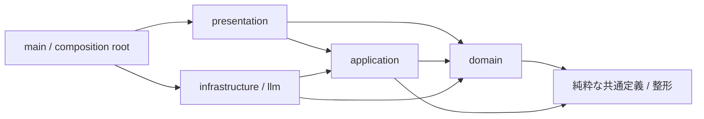
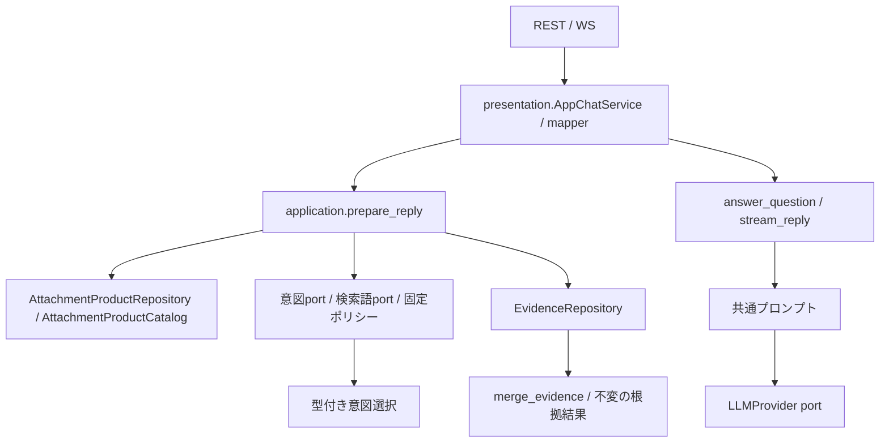

# バックエンドの構成と命名規則

このバックエンドは、**医薬品情報意思決定支援**という一つの業務ドメインを実装します。医薬品同定と添付文書根拠検索はそのサブドメインで、`application/chat` は両者を組み合わせる回答ユースケース、`presentation` はチャットを届ける配信層です。読み取り中心のため、会話集約、汎用Repository、Unit of Work、ドメインイベントは追加していません。Repository Interfaceは各 bounded context の `repositories.py` に定義し、SQLite、SQLAlchemy Core、Alembicは外側の層に閉じ込めます。

## 戦略設計上のドメイン境界

| 位置づけ | サブドメイン／層 | 業務上の責務 | 実装上の境界 |
| --- | --- | --- | --- |
| Core Subdomain | 問い合わせ解釈 | 質問意図を検索条件へ変換する | `domain/retrieval` |
| Core Subdomain | 添付文書根拠 | 出典付きの根拠を選び、文書単位の整合性を保持する | `domain/attachment` |
| Supporting Subdomain | 医薬品マスター | YJコードを識別子として医薬品コード対応表の10列を保持する | `domain/medicine` |
| Application | 回答準備・生成 | 2つのサブドメインとReader/Providerを順序付けて回答を作る | `application/chat` |
| Supporting Context | 知識取り込み・索引 | PMDA XMLを構造化し、検索可能な索引を作る | `data_tools`、`application/indexing` |
| Delivery / Generic | 対話配信 | REST/WebSocket、公開DTO、LLMストリームを提供する | `presentation`、`infrastructure/llm` |

`backend/domain` は一つのドメイン境界であり、bounded context ごとに純粋なモデルと規則を持ちます。`ChatMessage` や `ChatResponse` は回答ユースケースの入出力で、会話集約ではありません。会話履歴、権限、監査などに固有の業務規則が生じるまで、チャットを独立したドメインとして追加しません。

## 責務と配置

| 配置 | 責務 |
| --- | --- |
| `domain/attachment` | 添付文書 bounded context。`primitives.py`、`value_objects.py`、`entities.py`、`repositories.py`、`services.py`、`exceptions.py` に責務別の正本を置く |
| `domain/medicine` | 医薬品 bounded context。医薬品のPrimitive、Value Object、Entity/Aggregate、Repositoryを置く |
| `domain/retrieval` | 検索 bounded context。検索Primitive、検索条件、意図選択、根拠・取得経路の統合、根拠取得ポート、検索ポリシーを置く |
| `domain/foundation` | 業務非依存のPrimitive、Value Object、Entity/Aggregate Rootの基底、宣言型ガード、例外基底 |
| `domain/shared` | 複数コンテキストで共有する汎用正規化処理を置く。YJコードはmedicineが所有する |
| `application/chat` | 回答ユースケースの準備・生成・プロンプト・所有stream終了。`collect_search_criteria`は全検出器の完了を待ち、検索はその後に行う |
| `application/medicine` | フォームの医薬品候補提示。入力スナップショットから候補を選び、根拠検索には依存しない |
| `application/retrieval` | 意図・検索語のProtocolと検索条件生成 |
| `application/indexing` | 索引構築のユースケース・入出力契約 |
| `presentation` | Pydantic公開DTO、JSON変換、`AppChatService`、REST/WS、FastAPI依存関数 |
| `infrastructure` | SDK JSON解釈、JSON読取、Janome、SQLAlchemy Reader/Writer、Alembic runner、旧v3検証・移行 |
| `infrastructure/llm` | OpenAI/Gemini SDKと代替応答の実装 |
| `infrastructure/composition` / `main.py` | 具象の生成・接続、準備済みDBの検証、SDK/worker/engineの所有終了 |
| `config` | 接続設定と生成provider/modelの環境default供給 |
| `infrastructure/cli` | `build_search_index`、`migrate_legacy_index`の公開module入口 |
| `../package_inserts` | backend/data_toolsが共有する添付文書カタログ（Shared Kernel）と純粋整形 |

公開DTOの`ChatMessage`/`ChatResponse`/`ChatSource`/`MedicineMatch`は`presentation`に置き、REST JSON・WSイベント・OpenAPIの名前を維持します。applicationの同名モデルはフレームワーク非依存の入出力です。`IntentResult.candidates`が意図判定の業務契約で、`raw_response`は公開原本として保持します。applicationはSDKの`answers`/`choice`/`probabilities`を読まず、presentation mapperが公開JSONとの往復を担当します。

`Evidence`と医薬品の改訂情報は深い値として保持し、公開辞書は独立コピーにします。根拠集合はunit_idで最初に取得した内容を採用し、由来を統合して数値項目順に並べます。検出器の完了順に依存する既存の条件順・最初採用を維持します。PrimitiveやValue Objectの導入は既存の入力形式を狭めず、境界で受けた基本型を内部の明示的な型へ変換します。

## ドメイン基盤の利用

ドメインのimport制限は `pyproject.toml` のImport Linter契約に定義します。
`pnpm --filter backend lint` はRuffとImport Linterを実行します。依存だけの検査は `pnpm --filter backend lint:imports` です。
他コンテキストからの直接importは、所有元の `identifiers.py` に定義する公開ID Primitiveに限ります。添付文書の `DocumentId` は `domain/attachment/identifiers.py`、検索単位の `SearchUnitId` は `domain/retrieval/identifiers.py`、医薬品の `YjCode` は `domain/medicine/identifiers.py` が正本です。それ以外の情報はApplicationで利用側の型へ変換します。
各コンテキストの `identifiers.py` のプロジェクト内import先は `domain/foundation/primitives/identifiers.py` だけです。標準ライブラリは利用でき、IDは `EntityUUID` または `EntityStringId` を継承します。文字列ID基底はNFKC正規化・前後の余白除去・空値拒否を行います。
sharedは各業務コンテキストへ、foundationは業務コンテキスト・sharedへ依存できません。
domain全体からapplication・infrastructure・presentationへの依存も禁止します。静的な直接・間接依存を検査し、動的importは対象外です。
`backend.domain.*` を独立性契約の対象とするため、新規コンテキストにも自動適用されます。公開IDとfoundation・shared・json_typesへの依存を許可し、共通基盤から業務コンテキストへの逆依存は禁止します。`identifiers.py` から内部モデルへの依存も禁止し、公開IDモジュールを迂回経路にしません。

`domain/foundation` は他のコンテキストに依存しません。単一値を包む新しい型は
`foundation.primitives.base.DomainPrimitive[T]` を継承し、`validate()` で制約を定義します。
文字列・数値も `DomainPrimitive` に統一します。共通基底は
`foundation.primitives.primitives` の `BaseString` / `BaseFiniteFloat` です。
比較は同じ具象Primitive同士で行い、文字列の検索・ソート・数値計算には `.value` を使います。
API・JSON・SQLite・プロンプトの境界でも `.value` へ変換します。
基本型との暗黙の比較や `asdict()` による公開JSON生成は行いません。
`from_value()` は基本型から復元し、同じ具象型の不変Primitiveはそのまま受け取るため、
独自コンストラクタを持つモデルの `dataclasses.replace()` にも利用できます。
業務語彙（DocumentId、YjCode等）はsharedまたは対象コンテキストに置きます。

Entity / Value Object は型付け済みの値をコンストラクタへ渡して直接生成します。
引数の変換だけを行う `create()` は置かず、入力を取り込む利用側でPrimitive・VO・
不変コレクションを組み立てます。単一値の制約はPrimitive、複数の値の関係や
集約内の整合性はモデルの生成時に検証します。

複合値は `@dataclass(frozen=True)` の不変オブジェクトとして定義します。
検索のSearchCriteria、IntentCandidate、IntentSelectionに加え、MedicineMatch、
添付文書の全Value Objectが不変な値として保持されます。
汎用JSON型の正本は `domain.json_types.JsonValue` です。
文字列基底 `BaseString` はNFKC正規化と前後の余白除去を行い、空文字を禁止します（DDDの原則に則り、プリミティブ文字列はそもそも空文字を許容せず不正な状態のインスタンスを作らせません。省略可能な概念は `Primitive | None` のように型として表現します）。
添付文書Primitiveは直接継承して固有の例外型・形式制約だけを追加します。
添付文書の文字列Primitiveと検索確率も共通生成処理から `validate()` を呼び、
各コンテキストの制約だけを追加します。Enumの正規化基底もfoundationに置きます。
コレクションを含むモデルは、不変なタプルとして保持します。


エンティティ（Medicine、SearchUnit等）は各コンテキストで固有の識別子・不変条件・
比較操作を持つドメインモデルとして定義します。
一意識別子には `EntityUUID`（Python 3.14の標準 `uuid.uuid7()` によるUUIDv7採番）や、
`EntityStringId` を利用できます。
backendの実行環境はPython 3.14以上が必要です。
`.python-version` は3.14を指定し、pnpmのbackendスクリプトも `uv run --locked` 経由で
この環境を利用します。初期同期は `uv sync --project backend --python 3.14 --locked`、
`pylock.toml` の再生成は
`uv export --project backend --format pylock.toml --output-file backend/pylock.toml --no-emit-project` です。

例外基底の正本は `foundation.exceptions` です。ドメインプリミティブやValue Objectの
制約違反はすべて `DomainValidationError` に統一され、添付文書例外（`AttachmentDomainError`）とともに `DomainError` として捕捉できます。
旧 `domain.shared.exceptions` の利用側は `domain.foundation.exceptions` に移行します。

## 依存関係と実行時の呼出し

次はimport依存の図です。矢印の先の型・契約を参照します。



`domain`から`application`、presentation、infrastructure、SDK、catalog_loaderへの依存は禁止します。`application`はdomainと標準ライブラリ、純粋な`package_inserts.catalog_models`/`text_formatting`だけを参照します。永続化の具象IOは各 bounded context の `repositories.py` に定義したInterface越しに注入します。型確認用import・相対importも依存検査の対象です。

次は実行時の呼出しです。Reader/SDKは注入されたportの実装です。



確認応答ではprovider factoryを呼びません。環境defaultはconfigから供給し、呼出しで明示したprovider/modelを優先します。API・application・providerは所有するstreamを閉じます。mainは所有Jev SDK、worker、engineを終了し、実行中のto_threadは強制停止せず完了を待ちます。

## ディレクトリ構成

```text
backend/
├── main.py / project_paths.py / alembic.ini
├── presentation/        # routes、dependencies、chat_service、mapper、公開DTO
├── application/
│   ├── chat/            # prepare_reply、回答生成、prompt、stream終了
│   ├── medicine/        # フォームの候補提示
│   ├── retrieval/       # intent/keyword契約、条件生成
│   └── indexing/        # 索引構築契約とユースケース
├── domain/
│   ├── attachment/      # 添付文書 bounded context（責務別の直下モジュール）
│   ├── medicine/        # YJ医薬品マスター
│   ├── retrieval/       # 検索対象・条件・結果・根拠統合
│   ├── foundation/      # Primitive・不変Mapping・例外の共通基底
│   ├── shared/          # 合意した共有語彙・純粋な文字列照合
│   └── json_types.py    # 汎用JSON型
├── infrastructure/
│   ├── intent/          # TypeSafe adapterと境界mapping
│   ├── morphology/      # Janome adapterとkeyword_extraction
│   ├── persistence/     # Core schema、Reader/Writer、workers、旧v3移行
│   ├── sources/         # FileIndexSourceReader
│   ├── llm/             # SDK provider / fallback
│   ├── composition/     # index verifier、persistence lifespan
│   ├── cli/             # build_search_index、migrate_legacy_index
│   └── evidence_mapping.py
├── config/              # database_settings、generation_settings
├── migrations/          # env.pyとversions
└── tests/               # legacy_v3は未管理旧形式DBの生成専用Fixture
```

旧`backend.chat`/`retrieval`/`medicines`/`storage`/`jev`とcompositionの旧サービス再公開は削除しました。ドメインモデルも責務別の正本へ統一し、既知のリポジトリ内利用側は正本へ移行しています。公開起動点は`backend.main:app`/`create_app`、既存REST/WSルート、FastAPI DI関数、2つのCLI moduleです。リポジトリ外の旧Python import利用は確認対象外です。

## 命名規則

ファイルは`snake_case`で責務を示し、クラスは`PascalCase`、関数は動詞を先頭にします。APIルートは`*_routes.py`、外部判定adapterは`*_detector.py`/`*_classifier.py`、純粋な業務判断は`*_policy.py`、外部表現の変換は`*_mapping.py`/`*_mapper.py`です。添付文書の対応表は共通カタログに置きます。公開APIのスキーマ・項目・ルート名は互換性を維持します。基本型を業務上の意味で包むものは`primitives`、同一性を持たない不変値は`value_objects`、同一性とライフサイクルを持つものは`entities`、複数モデルを組み合わせる処理は`services`へ置きます。

## データベース運用とマイグレーション

データベースには SQLite（FTS5全文検索対応）を使用し、スキーマ管理には **Alembic**、クエリ実行には **SQLAlchemy Core** を採用しています。

### マイグレーション手順

```bash
# 最新スキーマへのアップグレード
uv run --project backend alembic -c backend/alembic.ini upgrade head

# ベース状態（全テーブル削除）へのダウングレード
uv run --project backend alembic -c backend/alembic.ini downgrade base
```

### 検索インデックスの構築

インデックス構築は、あらかじめマイグレーションが完了したデータベースに対して、単一トランザクションで安全に実行されます：

```bash
# 既定のパス (data_tools/structured/ -> .chat-search.sqlite3) でインデックス構築
uv run --project backend python -m backend.infrastructure.cli.build_search_index

# 任意のパスを指定して実行
uv run --project backend python -m backend.infrastructure.cli.build_search_index \
  --structured-dir data_tools/structured \
  --index-path data_tools/structured/.chat-search.sqlite3
```

### 未管理旧v3 SQLiteデータベースの移行

過去の自動構築スクリプト等で作成された未管理の旧v3データベースは、専用の移行コマンドで安全に別ファイルへ複製・検証・Alembic管理化します：

```bash
uv run --project backend python -m backend.infrastructure.cli.migrate_legacy_index \
  --source-index data_tools/structured/old-index.sqlite3 \
  --output-index data_tools/structured/.chat-search.sqlite3
```
- 元データベースの整合性を検証（PRAGMA integrity_check、JSONスキーマ、FTS5整合性）
- SQLite Online Backup API を用いて安全に整合複製（WALコミット済みデータも完全に反映）
- 複製先のみに対して Alembic stamp（`0001_v3_schema`）と upgrade を適用
- 移行前後の全レコード数・代表検索結果・指紋の完全一致を自動検証

## ポートとアダプターの拡張手順

新しい永続化ストレージ、検索検出器、LLMプロバイダーを追加する場合の手順：

1. **ポート（Protocol）の定義**:
   永続化・検索対象のRepository Interfaceは対象コンテキストの `backend/domain/<domain>/repositories.py` に、意図判定・キーワード抽出・LLMなどのユースケース用portは`backend/application/`にPython `typing.Protocol`で定義します。引数・戻り値は純粋なドメイン型または標準ライブラリ型にします。
2. **アダプターの実装**:
   `backend/infrastructure/` 配下に Protocol を満たす具象クラスを実装します。外部ライブラリへの依存はこのモジュール内に閉じ込めます。
3. **DIコンテナ / Lifespanへの配線**:
   `backend/infrastructure/composition/` 内で具象クラスを生成し、`backend/main.py` の Lifespan スコープまたは `backend/presentation/dependencies.py` の依存関数として登録します。
4. **テスト時のオーバーライド**:
   FastAPI の `app.dependency_overrides[get_chat_service] = ...` を使用して、テストダブル（Mock/Fake）を注入してテストします。

## 開発コマンド

DB設定・CLIに渡す相対パス（`MEDI_CHAT_STRUCTURED_DIR`、
`MEDI_CHAT_INDEX_PATH`、SQLite URLの相対DBパスを含む）は、
実行ディレクトリではなくリポジトリルートを基準に解決します。
絶対パスの明示指定も利用できます。実行時にはDB接続用に絶対パスへ解決します。

リポジトリ直下で実行します。

```bash
# 依存関係のインストール
pnpm install

# 型チェック (Pyright) - 全ファイル 0 errors を維持
pnpm typecheck:python

# リンター & フォーマッター
uv run --project backend python -m ruff check backend data_tools package_inserts
uv run --project backend python -m ruff format --check backend data_tools package_inserts

# 全体テストスイートの実行
uv run --project backend pytest backend/tests data_tools/tests

# 開発サーバー起動
pnpm dev:backend
```

### 添付文書Primitiveの責務

`medicine/entities.py` の `Medicine` は医薬品コード対応表の一製品を表し、YJコードを必須IDとします。
レセ電・一般名コード、名称2種類、一般名処方の標準的記載、適用・廃止日を保持します。
添付文書ID・URL・改訂情報や、文書から導出した成分IDを持ちません。
`MedicineCodeTableReader` はExcelの10列を読み、日付の `99999999` と任意欄の空値を `None` に変換します。
名称は原文を保持し、一般名処方の標準的記載を成分名として扱いません。
既存チャットの索引は引き続き添付文書掲載情報を使います。`AttachmentProductRecord` と
`AttachmentProductMatch` はattachmentが所有し、照合・別名生成は
`application/indexing/medicine_catalog.py` の `AttachmentProductCatalog` で調整します。
フォームの候補提示は `application/medicine/suggestions.py` の `MedicineSuggester` が担当します。
現在の候補データは添付文書掲載製品です。起動時に公開ID・名称・別名だけを
候補提示用の入力スナップショットへ変換し、添付文書モデルや根拠検索サービスを直接保持しません。
`AttachmentProductCatalog` は回答準備の製品解決に限定し、フォームのサジェスト操作は持ちません。
医薬品マスターを候補データへ接続する処理は、今回追加していません。

モデル属性と公開JSONの文書識別子は `document_id`、複数形は `document_ids` に統一します。
既存DBの列と構造化JSONLの `document_key` は保存形式の契約として保持し、Infrastructureで変換します。

原本の識別・項目・製品・参照には `DocumentId`、`SectionCode`、
`AttachmentProductCode`、`AttachmentUrl` を使います。番号付き項目を扱う
原本モデルは `SectionCode.require_numbered()` で階層番号を検証します。
検索条件の項目コードはretrievalの `SearchSectionCode` を使います。
添付文書掲載製品の参照文字列と改訂情報はattachmentの `PmdaUrl` と
`AttachmentProductRevision` が所有します。
attachmentは原本文書の構造と整合性を所有し、Repositoryは文書取得だけを公開します。
原文から派生する `SearchUnit`、そのID・本文・種類・選択条件と検索処理はretrievalが所有します。
`SearchUnit` は索引で識別される検索前の本文単位Entityです。
`Evidence` は `retrieval/value_objects.py` の検索後の出典・取得経路付き結果VOで、
JSONLという保存形式には依存しません。根拠の重複排除・取得経路の統合は
`retrieval/services.py` の状態を持たない `merge_evidence()` が担当します。
最初の原文と既存の取得経路を保持し、経路を和集合で統合します。
番号付き項目・文字列項目・空項目の順に並べ、同項目では検索単位ID順の不変タプルを返します。
検索実行時の取得経路を表す
`DetectionSource` は `domain/retrieval/primitives.py` が所有します。

検索結果に載せる改訂・参照・項目・表の列のスナップショットはretrievalの
Value Objectとして保持します。検索ポートは文書IDを公開する入力契約を使います。
これらのMapping操作と入力・出力の独立コピーは、汎用基底の
`domain/foundation/value_objects.py` の `ImmutableMapping` に集約しています。
文書内の製品重複と項目の親子関係は `AttachmentDocument` が検証し、
取得経路は `frozenset[DetectionSource]` で保持し、公開JSONはEnum定義順の配列に変換します。
経路がない場合は空集合・空配列とし、組み合わせ専用のEnumや対応表は定義しません。
