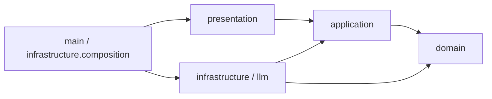
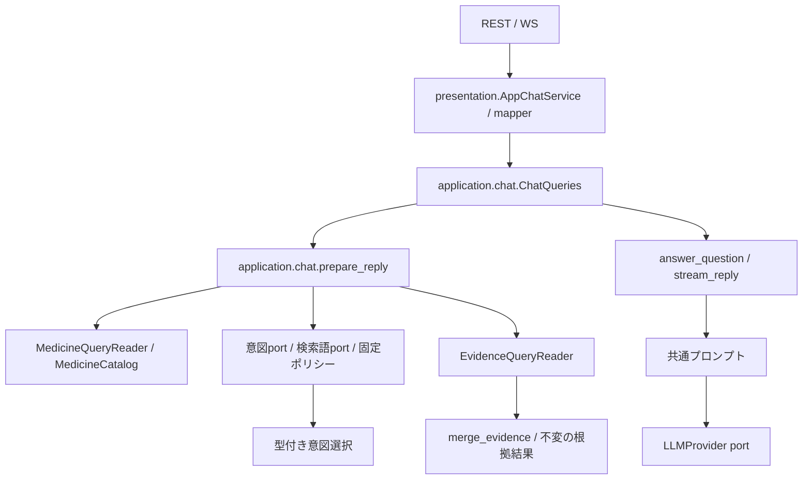

# バックエンドの構成と命名規則

このバックエンドは、**医薬品情報意思決定支援**という一つの業務ドメインを実装します。医薬品同定と添付文書根拠検索はそのサブドメインで、`application/chat` は両者を組み合わせる回答ユースケース、`presentation` はチャットを届ける配信層です。読み取り中心のため、会話集約、汎用Repository、Unit of Work、ドメインイベントは追加していません。原本文書のRepositoryはDomainの `repositories.py`、根拠検索ポートはApplicationの `retrieval/queries/readers/evidence_query_reader.py` に定義し、PostgreSQL、SQLAlchemy Core、Alembicは外側の層に閉じ込めます。

## チャットの入出力上限

Vercel向けのNeon接続・10MiB XML分割取り込み・移行手順は[デプロイ準備](../development/vercel-deployment.md)を参照してください。

RESTとWebSocketは重複のない対象YJコードを1～50件受け付けます。WebSocketは1回につき最大50メッセージ、各本文は最大4,000文字です。画面は会話全文を保持し、送信には直近24件の完了した往復と今回の質問を使います。失敗・中断・空の回答・4,000文字を超える本文がある往復は送信履歴から除外し、本文の途中切断は行いません。

### WebSocket の要求と接続寿命

`/api/ws` と `/ws/chat` は同じ契約です。`message` と `abort` はUUID v4文字列の `request_id` が必須です。`sources`、`retrieval_status`、`jev_response`、`notices`、`text_delta` と終端の `text_done` / `error` / `aborted` は、そのIDをcanonical表記で返します。旧形式は受理しません。本文等の入力不正は当該IDの `error`、ID不正・不正JSON・非objectは `connection_error` (`invalid_payload`)、未知typeは `unsupported_type` です。接続は後続の有効要求を処理できます。

Presentationが接続あたり1つの生成taskを所有し、準備・無音生成・終了処理中も受信します。別要求と同ID重複は `control_error` (`busy`)、非activeへのabortは `not_active` です。受理した要求の終端は接続維持中に1つだけ確定します。abortはtaskをcancelし、準備・stream・SDK・DBの所有終了をjoinした後に `aborted` を返します。切断でもcancel/joinし、全sendを直列化します。native workerの強制停止や外部サービスの課金停止は保証しません。clientはIDとsocket世代を照合し、中断往復を次の履歴から除外します。

JSON `ping` / `pong` はUUID v4の `ping_id` を対応付けます。前景openの正常受信から30秒でpingを1件、対応pongを5秒待ちます。業務受信はidleを延長しますが発行済pingの締切は延長しません。timeout/送信例外は旧socketを一度だけ失効させ、既存backoffで再接続します。hidden中は監視timerを止め、復帰時に新pingのpongを確認してから業務送信を許可します。背景timerの遅延やOS sleep中の35秒以内検知は保証しません。

clientは通常の接続待ちだけ未送信1件を60秒保留できます。受付時の本文・対象YJ・model・完了履歴・入力tokenをcopyし、復旧時に期限を再確認して一度だけ送ります。取消・期限・認証拒否・unmountで後から送らず、取消/期限の質問は元contextを表示して明示再編集できます。別draftは保持/置換を選べます。transportの `sent` はブラウザsend呼出し成功であり受領ackではありません。`not_open` は未送信、`uncertain` は試行後の到達不明です。送信後切断/uncertainは中断表示にし自動再送しません。恒久queue、replay、冪等実行保証はありません。request ID・保留・接続管理はDomain/DB契約へ持ち込みません。

起動時の環境設定は、既存のプロセス環境を優先します。未設定値だけをdotenvから補い、読み込むファイルはリポジトリルートの`.env.local`だけです。DB管理CLIも同じ設定を読み込みます。`PYTHON_DOTENV_DISABLED=1`ではファイルを読みません。

`pnpm dev:backend`の起動監視は`/api?__medi_chat_dev_monitor=1`を使用します。開発用Uvicornログ設定で、このloopback監視の200/401だけをアクセスログから除外します。認証は通常どおり実行し、一般の401や監視のサーバーエラーは記録します。応答停止時の自動再起動も維持します。

## 戦略設計上のドメイン境界

| 位置づけ | サブドメイン／層 | 業務上の責務 | 実装上の境界 |
| --- | --- | --- | --- |
| Core Subdomain | 問い合わせ解釈 | 質問意図を検索条件へ変換する | `application/retrieval` |
| Core Subdomain | 添付文書根拠 | 出典付きの根拠を選び、文書単位の整合性を保持する | `domain/attachment` |
| Supporting Subdomain | 医薬品マスター | YJコードを識別子として医薬品コード対応表の10列を保持する | `domain/medicine` |
| Application | 回答準備・生成 | 2つのサブドメインとReader/Providerを順序付けて回答を作る | `application/chat` |
| Supporting Context | 知識取り込み・索引 | PMDA XMLを構造化し、検索可能な索引を作る | `application/attachment_import`、`infrastructure/pmda_xml`、`application/indexing` |
| Delivery / Generic | 対話配信 | REST/WebSocket、公開DTO、LLMストリームを提供する | `presentation`、`infrastructure/llm` |

`backend/domain` は一つのドメイン境界であり、bounded context ごとに純粋なモデルと規則を持ちます。`ChatMessage` や `ChatResponse` は回答ユースケースの入出力で、会話集約ではありません。会話履歴、権限、監査などに固有の業務規則が生じるまで、チャットを独立したドメインとして追加しません。

## 責務と配置

| 配置 | 責務 |
| --- | --- |
| `domain/attachment` | 添付文書 bounded context。`primitives.py`、`value_objects.py`、`entities.py`、`services.py`、`exceptions.py` に責務別の正本を置く |
| `domain/medicine` | 医薬品の名称・識別子、照合結果を所有する |
| `domain/foundation` | 業務非依存のPrimitive、Value Object、Entity/Aggregate Rootの基底、宣言型ガード、例外基底 |
| `domain/shared` | 複数コンテキストで共有する汎用正規化処理を置く。YJコードはmedicineが所有する |
| `application/chat` | `ChatQueries` を中心に、会話から質問を取り出し、retrievalの結果を使って回答を準備・生成する。プロンプトと所有stream終了を担当する |
| `application/medicine` | 医薬品照合カタログ、文書参照との投影、フォームの医薬品候補提示（`MedicineSuggester.from_registered_medicines` による全候補の投影）。候補提示は根拠検索に依存しない |
| `application/retrieval` | 選択済みYJコードだけから医薬品を解決し、検索条件を生成して根拠を取得・統合する。共通定義の常時取得項目（1・2・8）は質問による絞り込みなしに取得し、WebSocketでは検出器の完了前に配信する。通常検索との重複を除き、取得理由 `always` と通常の取得経路を保持する。常時取得項目を質問意図へ加えない。WebSocketでは固定キーワード・形態素解析の各検出完了時にローカル根拠を累積配信し、Jev完了後に全検出条件の統合根拠で更新する。固定キーワードの配信は形態素解析を待たない。登録済み製品が選択されていない場合は先行配信しない。RESTと回答生成は全検出完了後の根拠を使う |
| `application/indexing` | 索引構築のユースケース・入出力契約 |
| `presentation` | Pydantic公開DTO、JSON変換、`AppChatService`（DTO変換アダプター）、REST/WSルーター、`dependencies.py`（全FastAPI `Depends` 関数の集約）。`domain` および `infrastructure` には一切依存しない |
| `infrastructure` | SDK JSON解釈、JSON読取、Janome、SQLAlchemy Reader/Writer、Alembic runner、共通payload変換（`index_payloads.py`、`evidence_mapping.py`） |
| `infrastructure/llm` | OpenAI/Gemini SDKと代替応答の実装 |
| `infrastructure/composition` / `main.py` | `app_lifespan.py`（`create_app_lifespan`）で具象の生成・接続・準備済みDB検証・SDK/worker/engineの所有終了を集約し、`main.py`（`create_app`）はCORS・ルーター登録とlifespan委譲のみを担当する |
| `config` | 接続設定と生成provider/modelの環境default供給 |
| `infrastructure/cli` | `manage_postgres`の明示migration/初期登録/export/rebuild/maintenance、`structure_pmda_xml`のoffline変換入口 |
| `infrastructure/package_insert_definitions` | 各層が所有する型付き定義の用途別組立と、各アダプター向け設定型（`definition_settings.py`）の所有。項目構造・意味はDomain、常時参照・検索規則はApplication、タグ対応・SDK形式はInfrastructureが所有する |

公開DTOの`ChatMessage`/`ChatResponse`/`ChatSource`/`MedicineMatch`は`presentation`に置き、REST JSON・WSイベント・OpenAPIの名前を維持します。applicationの同名モデルはフレームワーク非依存の入出力です。`IntentResult.candidates`が意図判定の業務契約で、`raw_response`は公開原本として保持します。applicationはSDKの`answers`/`choice`/`probabilities`を読まず、presentation mapperが入力DTOからApplication入力への変換と、Application結果から公開JSONへの変換を担当します。準備済みの回答はApplicationモデルのまま生成まで保持し、出力DTOから内部モデルへ復元しません。

`Evidence`と医薬品の改訂情報は深い値として保持し、公開辞書は独立コピーにします。根拠集合はunit_idで最初に取得した内容を採用し、由来を統合して数値項目順に並べます。検出器の完了順に依存する既存の条件順・最初採用を維持します。PrimitiveやValue Objectの導入は既存の入力形式を狭めず、境界で受けた基本型を内部の明示的な型へ変換します。

医薬品候補の取得は `application/medicine/queries/readers/medicine_query_reader.py` の `MedicineSnapshotProvider` を使い、同じ公開世代のIDと医薬品Readerだけを要求します。根拠検索側の `RetrievalSnapshotProvider` は根拠Readerも提供します。Infrastructureの世代runtimeは両契約を満たし、どちらも `acquire()` の終了まで同じ世代とleaseを保持します。

`infrastructure/sources` は明示した入力ファイルの読取を担当します。原本bytea・完全構造JSONB・検索投影の保存は `persistence/postgres_registration.py`、read-only MVCC読取は `persistence/postgres_runtime.py`、起動時のDB内整合性検証は `persistence/postgres_readiness.py` が担当します。persistenceはXML/source adapterへ依存せず、完全Domain構造は明示mapperで往復します。Composition RootがdecoderをImportServiceへ、encoderをpublisherへ注入し、engine/workersの寿命を所有します。

### 出力DTOの逆変換を防ぐ検査

`pnpm --filter backend lint`はRuff・Import Linterに加え、`lint:boundaries`でAST検査を実行します。Presentationの関数が出力専用の`ChatResponse`・`ChatSource`・`MedicineMatch`を引数に受け、Application型を返す、またはApplicationの型・関数を呼ぶ経路を禁止します。入力`ChatMessage`の変換、出力への変換、送信用callbackは許可します。

この検査は直接import・alias・修飾名・文字列型注釈・コレクション内の型を対象にします。`Any`や辞書に型を消した経路、動的import、別名の再代入を通じたデータフロー全体を証明するものではありません。型検査と、準備済みApplication結果の同一性・内部情報を保持するテストを併用します。

## リンターによるアーキテクチャ制約とドメイン基盤の利用

アーキテクチャ境界とレイヤー内モジュール階層は、`backend/pyproject.toml` の **Import Linter（全24契約）**、**Ruff（`TID251` 等の禁止API検査）**、および `backend/tests/architecture/test_architecture_dependencies.py` の **AST静的境界テスト** によって機械的に強制しています。
`pnpm --filter backend lint` はRuffとImport Linterを一括実行します（依存契約のみの検査は `pnpm --filter backend lint:imports`）。

### リンター駆動で実装を効率化する設計方針

1. **例外リスト（`ignore_imports`）に頼らない厳格・シンプルな境界**:
   - 「Presentation層からDomain層への一部のみ許可」のような例外運用は、Import Linterが間接推移依存（`Presentation -> Domain -> Domain内部`）まで遮断する性質上、例外リストの肥大化や判断の迷いを招きます。
   - そのため、**`Presentation does not depend on domain`（例外ゼロ）** のようにレイヤー間の禁止ルールを厳格・単純化し、ドメイン例外の変換や境界型の受け渡しはすべて `Application` 層で完結させています。
2. **レイヤー間の単方向依存（Onion Rings）**:
   - `Domain` は最内層として外部レイヤーに一切依存しません。
   - `Application` は `Domain` のみに依存します。
   - `Presentation` は `Application` と `Config` のみに依存します（`Domain`・`Infrastructure` への依存は完全禁止）。
   - `Infrastructure` は `Application`・`Domain`・`Config` に依存し、`Presentation` には依存しません（Composition Rootの配線のみ）。
3. **レイヤー内部のモジュール階層・独立性の強制**:
   - **Domain内部**: コンテキスト間（`attachment` / `medicine`）は独立し、他コンテキストからは公開ID（`identifiers.py`）のみ参照可能です。さらにコンテキスト内部でも `identifiers -> exceptions -> primitives -> value_objects -> entities -> repositories -> services` の単方向階層を強制しています。
   - **Application内部**: `chat -> retrieval -> indexing -> medicine`、`retrieval -> medicine` および `attachment_import -> file_upload` の有向パイプライン境界を強制し、逆方向参照や循環を防止します。
   - **Presentation内部**: `routes -> dependencies -> services (AppChatService) -> mappers -> DTO models` の5段階の階層を強制し、ルーターが `request.app.state` を直接読むことや、DTOモデルが上位サービスを参照することを防ぎます。
   - **Infrastructure内部**: 外部技術アダプター（`llm` / `intent` / `morphology` / `pmda_xml`）間の相互独立、`persistence -> sources` 禁止、`package_insert_definitions` から他アダプターへの依存禁止、`index_payloads` / `evidence_mapping` からアダプターパッケージへの依存禁止を契約化しています。

他コンテキストからの直接importは、所有元の `identifiers.py` に定義する公開ID Primitive（**1コンテキスト＝1公開ID**）に限ります。添付文書の `DocumentId` は `domain/attachment/identifiers.py`、医薬品の `YjCode` は `domain/medicine/identifiers.py` が正本です。それ以外の情報はApplicationで利用側の型へ変換します。検索単位の `SearchUnitId` はDomainの公開IDではなく、`application/indexing/values.py` が所有する投影のIDです。
各コンテキストの `identifiers.py` のプロジェクト内import先は `domain/foundation/primitives/identifiers.py` だけです。標準ライブラリは利用でき、IDは `EntityUUID` または `EntityStringId` を継承します。文字列ID基底はNFKC正規化・前後の余白除去・空値拒否を行います。
sharedは各業務コンテキストへ、foundationは業務コンテキスト・sharedへ依存できません。
Domainの構造規則と禁止例の検証は[Domainハーネス](domain-architecture.md)を参照してください。標準lintとCIで強制し、新規コンテキストも自動検出します。

domain全体からapplication・infrastructure・presentationへの依存も禁止します。静的な直接・間接依存を検査し、Domainハーネスでは動的import自体も禁止します。
`backend.domain.*` を独立性契約の対象とするため、新規コンテキストにも自動適用されます。公開IDとfoundation・sharedへの依存を許可し、共通基盤から業務コンテキストへの逆依存は禁止します。`identifiers.py` から内部モデルへの依存も禁止し、公開IDモジュールを迂回経路にしません。

`domain/foundation` は他のコンテキストに依存しません。単一値を包む新しい型は
`foundation.primitives.base.DomainPrimitive[T]` を継承し、`validate()` で制約を定義します。
文字列・数値も `DomainPrimitive` に統一します。共通基底は
`foundation.primitives.primitives` の `BaseString` / `BaseFiniteFloat` です。
比較は同じ具象Primitive同士で行い、文字列の検索・ソート・数値計算には `.value` を使います。
API・JSON・DB・プロンプトの境界でも `.value` へ変換します。
基本型との暗黙の比較や `asdict()` による公開JSON生成は行いません（Ruff `TID251` で `dataclasses.asdict` を禁止）。
`from_value()` は基本型から復元し、同じ具象型の不変Primitiveはそのまま受け取るため、
独自コンストラクタを持つモデルの `dataclasses.replace()` にも利用できます。
業務語彙（DocumentId、YjCode等）はsharedまたは対象コンテキストに置きます。

Entity / Value Object は型付け済みの値をコンストラクタへ渡して直接生成します。
引数の変換だけを行う `create()` は置かず（ASTテストで禁止）、入力を取り込む利用側でPrimitive・VO・
不変コレクションを組み立てます。単一値の制約はPrimitive、複数の値の関係や
集約内の整合性はモデルの生成時に検証します。

複合値は `@dataclass(frozen=True)` の不変オブジェクトとして定義します。
検索のSearchCriteria、IntentCandidate、IntentSelectionに加え、MedicineMatch、
添付文書の全Value Objectが不変な値として保持されます。
汎用JSON型の正本は `domain.foundation.json_types.JsonValue` です。
文字列基底 `BaseString` はNFKC正規化と前後の余白除去を行い、空文字を禁止します。省略可能な概念は `Primitive | None` として表現します。原表記を保持する名称は `DomainPrimitive[str]` から定義し、空白だけの値は拒否しつつNFKCやtrimを適用しません。

medicineの販売名・一般名・英名・読み名称はそれぞれ `BrandName` / `GenericName` / `EnglishName` / `HiraganaName`、検出別名は `MatchedAlias` が単一値を検証します。`MedicineNames` VOが名称群を保持し、`MedicineProduct` は公開IDと名称VOを保持します。`MedicineMatch` も名称・YJコードのPrimitiveを保持します。値の内容検証と正規化はPrimitiveが所有し、VO/Entityでは再実行しません。型付きフィールドと不変コレクションの整合はPyright/mypyで確認します。VO/Entityの `__post_init__` は複数値の関係・集約の不変条件がある場合だけ定義し、型確認だけの処理や汎用 `_require` ヘルパーは置きません。

任意名称の欠落・空文字・空白だけの値は取り込み境界で `None` に変換し、数値等は文字列化せず拒否します。Applicationの読み取り投影は `.value` と従来の空文字を公開します。照合用の正規化は原表記とは分けて導出します。`YjCode` は既存ID基底のNFKC/trim後に12文字ASCII英数字を要求し、コードの実在性は保証しません。形式制約はID基底の `value_pattern` で宣言し、公開IDモジュールから例外モジュールへ依存しません。

PresentationはYJコードを `str` として受け取り、必須・配列件数等の入力契約を検証します。YJ固有の形式制約は重ねず、Applicationの検索・根拠取得入口で `parse_yj_codes()` がDomain Primitiveへ変換し、正規化後の重複も拒否します。不正値は `InvalidMedicineInput` へ変換し、RESTは422、WebSocketは接続を維持したエラー応答を返します。カタログ内部は `Sequence[YjCode]` のみを扱い、文字列からの暗黙変換を行いません。
attachmentの販売名・英名・正式項目名・改訂ラベル・版表記も原表記を保持します。本文の `AttachmentText` は有効な空本文を保持し、非空の名称とは区別します。`RevisionYearMonth` は正規化後のASCII年月（0001年～9999年、01月～12月）を検証します。

`AttachmentSourceOrder` は0以上の整数を表し、boolを拒否します。VOの文脈比較には出現順を含めず、XML decoder・永続化mapper・検索投影で明示変換します。保存JSONの `source_order` は従来の整数/Noneです。VOと `AttachmentDocument` は重複・親子関係等の業務上の不変条件を検証します。XML/保存JSONなど外部の生データの型は入力・復元境界で確認し、明示的にPrimitiveと不変コレクションを組み立てます。

登録時のYJ形式は公開 `YjCode` へ集約し、`RegistrationVersion` は登録対象の製品集合が非空であることを検証します。アップロードSHAもPresentationではstrとして受け取り、Applicationの `UploadSpec` が `AttachmentSha256` で検証・正規化します。不正入力は既存の入力エラー形式へ変換します。ファイルサイズ等の通信上の制約は維持します。
添付文書の文字列Primitiveと検索確率も共通生成処理から `validate()` を呼び、
各コンテキストの制約だけを追加します。Enumの正規化基底もfoundationに置きます。
コレクションを含むモデルは、不変なタプルとして保持します。

retrievalの `Evidence` は表示製品名・一般名・種類・出典をOptional Primitive、本文を空文字も保持する `EvidenceExcerpt` として持ちます。公開JSONとプロンプトでは `.value` を明示的に取り出し、不在は既存の空文字へ戻します。VOと `SearchUnit` は型付きの値を受け取り、基本型・要素型の確認だけの生成時処理は置きません。表の列位置/結合数は `SearchColumnIndex` / `SearchCellSpan`、固定意図の順位は `KeywordPriority` が検証します。

検索ポリシーの語彙は原表記を保持する `SearchPolicyTerm` とし、症状ルールは `SymptomKeywordRule` のtupleで保持します。元の設定辞書やlistをDomainに保持しません。設定JSONの形式と、検索時の語彙・順序・重複排除は維持します。根拠の改訂・参照は未知metadataを保持し、項目/列のMappingは空の原文セル・自由な番号も保持します。


エンティティ（MedicineProduct、SearchUnit等）は各コンテキストで固有の識別子・不変条件・
比較操作を持つドメインモデルとして定義します。
一意識別子には `EntityUUID`（Python 3.14の標準 `uuid.uuid7()` によるUUIDv7採番）や、
`EntityStringId` を利用できます。
backendの実行環境はPython 3.14以上が必要です。
ルートとbackendの`.python-version`、CIは3.14.9を指定し、pnpmのbackendスクリプトも `uv run --locked` 経由で
この環境を利用します。初期同期は `uv sync --project backend --python 3.14.9 --locked` です。
Vercelは3.14系列を選択し、実際のパッチ版はプラットフォームが管理します。
`pylock.toml` の再生成は
`uv export --project backend --format pylock.toml --output-file backend/pylock.toml --no-emit-project` です。

例外基底の正本は `foundation.exceptions` です。ドメインプリミティブやValue Objectの
制約違反はすべて `DomainValidationError` に統一され、添付文書例外（`AttachmentDomainError`）とともに `DomainError` として捕捉できます。
旧 `domain.shared.exceptions` の利用側は `domain.foundation.exceptions` に移行します。

## 依存関係と実行時の呼出し

`application/chat` は `ChatQueries` を通じて `application/retrieval.retrieve_evidence` を呼び、
チャットやLLMに依存しない `RetrievalResult` を受け取ります。
retrievalは会話メッセージ・回答生成・LLM Providerを参照しません。
この依存方向はImport Linterで間接依存も含めて検査します。
LLMによる回答生成の契約はchat、SDKの実装はInfrastructureが所有します。

次はimport依存の図です。矢印の先の型・契約を参照します。



`domain`から`application`、`presentation`、`infrastructure`、SDK、JSON loaderへの依存は禁止します。`application`は`domain`と標準ライブラリ、および許可されたApplication内の下流機能だけを参照します。`presentation`は`application`と`config`だけを参照し、`domain`・`infrastructure`への依存は全面禁止します。添付文書の正式名称はattachmentのSectionTaxonomyが所有し、Applicationのdefinition_projectionで用途側へ写します。検索規則/整形はretrieval、回答指示はApplication、JSON/XML/Jev/Janome設定はInfrastructure（`package_insert_definitions/definition_settings.py`）に置きます。永続化の具象IOは、Domainの文書RepositoryとApplicationの検索ポートを通して注入します。型確認用import・相対importも依存検査の対象です。

次は実行時の呼出しです。Reader/SDKは注入されたportの実装です。



確認応答ではprovider factoryを呼びません。環境defaultはconfigから供給し、呼出しで明示したprovider/modelを優先します。API・application・providerは所有するstreamを閉じます。lifespan（`infrastructure/composition/app_lifespan.py`）は所有Jev SDK、worker、engineを終了し、実行中のto_threadは強制停止せず完了を待ちます。

## ディレクトリ構成

```text
backend/
├── main.py / project_paths.py / alembic.ini
├── presentation/        # routes、dependencies、chat_service(DTO adapter)、mapper、公開DTO
├── application/
│   ├── chat/            # ChatQueries、prepare_reply、回答生成、prompt、stream終了
│   ├── medicine/        # 製品解決カタログ、フォームの候補提示(MedicineSuggester)
│   ├── retrieval/       # intent/keyword契約、条件生成、根拠取得ユースケース
│   ├── attachment_import/ # 添付文書取り込み・結果読取ユースケース
│   ├── file_upload/     # 分割転送・原本の一時保存
│   └── indexing/        # 索引構築契約とユースケース
├── domain/
│   ├── attachment/      # 添付文書 bounded context（責務別の直下モジュール）
│   ├── medicine/        # YJ医薬品マスター・別名優先度規則
│   ├── foundation/      # Primitive・不変Mapping・例外・JsonValueの共通基底
│   └── shared/          # 合意した共有語彙・純粋な文字列照合
├── infrastructure/
│   ├── intent/          # TypeSafe adapterと境界mapping
│   ├── morphology/      # Janome adapterとkeyword_extraction
│   ├── package_insert_definitions/ # 型付き定義のassemblyと各adapter用設定・投影
│   ├── persistence/     # Core schema、Reader/Writer、GenerationRuntime、Publisher、workers
│   ├── pmda_xml/        # PMDA XML decoder / artifact encoder
│   ├── sources/         # FileIndexSourceReader
│   ├── llm/             # SDK provider / fallback
│   ├── composition/     # app_lifespan(DI配線)、index verifier、persistence lifespan
│   ├── cli/             # manage_postgres、structure_pmda_xml
│   ├── evidence_mapping.py
│   ├── index_payloads.py # XML非依存のJSON/検索単位payload変換
│   └── import_payloads.py # 解析・成果物生成・公開の内部契約
├── config/              # database_settings、generation_settings
├── migrations/          # env.pyとversions
└── tests/               # 現在形式の生成・保存・検索と未管理DB拒否を検証
```

旧`backend.chat`/`retrieval`/`medicines`/`storage`/`jev`とcompositionの旧サービス再公開は削除しました。ドメインモデルも責務別の正本へ統一し、既知のリポジトリ内利用側は正本へ移行しています。公開起動点は`backend.main:app`/`create_app`、既存REST/WSルート、FastAPI DI関数、用途別CLI moduleです。リポジトリ外の旧Python import利用は確認対象外です。

## 命名規則

ApplicationはFeature-firstで、commands/queriesのSingle-File Sliceを基本とします。共有サービス・モデル・DTO・外部契約は更新側または参照側へ閉じ、Feature直下のservices/ports/models/DTOと更新・参照を束ねる窓口は置きません。必要な役割だけを置きます。配置・公開範囲・依存・循環は[Applicationハーネス](application-architecture.md)と `scripts/checks/application_architecture.py` を正典として全Featureに強制します。

ファイルは`snake_case`で責務を示し、クラスは`PascalCase`、関数は動詞を先頭にします。APIルートは`*_routes.py`、外部判定adapterは`*_detector.py`/`*_classifier.py`、純粋な業務判断は`*_policy.py`、外部表現の変換は`*_mapping.py`/`*_mapper.py`です。添付文書の編集規約は[Infrastructure定義ソース](../../backend/infrastructure/package_insert_definitions/README.md)を参照します。組立束をサービスへ渡さず、用途別policy/settingsだけを注入します。公開APIのスキーマ・項目・ルート名は互換性を維持します。基本型を業務上の意味で包むものは`primitives`、同一性を持たない不変値は`value_objects`、同一性とライフサイクルを持つものは`entities`、複数モデルを組み合わせる処理は`services`へ置きます。

## データベース運用とマイグレーション

PostgreSQL 18、SQLAlchemy Core、Alembicを使用します。接続poolとworkerはlifespanが所有します。ローカルDockerの起動・owner/runtime権限分離は[ローカル開発](../development/local-development.md#ローカルpostgresqlの準備)を参照してください。

### マイグレーション手順

ownerのURLを`MEDI_CHAT_MIGRATION_DATABASE_URL`へ、アプリのDML用URLを`MEDI_CHAT_DATABASE_URL`へ設定します。URLの値をCLI引数やログへ出さず、環境変数名で対象を明示します。

```bash
pnpm db:migrate
pnpm db:initialize
```

初期登録は空の登録台帳だけを対象とし、既存DBを置換しません。旧SQLite/生成JSONLを読み戻す互換・移行・起動fallbackはありません。元XML/図を空PGへ再登録します。明示Alembic設定は`backend/postgres-alembic.ini`です。通常startup/publisherはDDLを実行しません。

### 検索インデックスの構築

原本からの新規登録はWebまたは次の明示CLIを使います。

```bash
uv run --project backend --locked python -m backend.infrastructure.cli.structure_pmda_xml new.xml --register --database-env MEDI_CHAT_DATABASE_URL
```

保持された完全Domain構造から投影を再構築する場合は`pnpm db:rebuild`（public schema）です。直接CLIを使う場合は`manage_postgres --database-env <owner URL変数名> --schema <対象schema> rebuild --confirm-schema <同じschema>`を明示します。原XMLの再decodeや入力ディレクトリ再走査は行いません。登録receipt・原本/図bytea・公開pointerを保持し、破損した原本/完全構造・確認不一致では書き込みません。

```bash
pnpm db:maintenance
pnpm db:export --version-id <document_id:sha256> --output-dir <新規出力先>
```

exportは原本byteaと図の元bytesを出力します。清掃は参照0payloadをDB transactionで回収し、receipt/tombstoneは残します。保存元ファイルや別schemaを削除する処理はありません。

### 添付文書データの再生成

`pnpm build:data`または`structure_pmda_xml --source-dir ... --output-dir ...`は確認用の純粋なoffline変換です。JSONLを生成してもPGへ公開登録しません。入力・出力の相対パスはリポジトリroot基準です。

## ポートとアダプターの拡張手順

新しい永続化ストレージ、検索検出器、LLMプロバイダーを追加する場合の手順：

1. **ポート（Protocol）の定義**:
   永続化・検索対象のRepository Interfaceは対象コンテキストの `backend/domain/<domain>/repositories.py` に、意図判定・キーワード抽出・LLMなどのユースケース用portは`backend/application/`にPython `typing.Protocol`で定義します。引数・戻り値は純粋なドメイン型または標準ライブラリ型にします。
2. **アダプターの実装**:
   `backend/infrastructure/` 配下に Protocol を満たす具象クラスを実装します。外部ライブラリへの依存はこのモジュール内に閉じ込めます。
3. **DIコンテナ / Lifespanへの配線**:
   `backend/infrastructure/composition/` 内で具象クラスを生成し、`backend/main.py` の Lifespan スコープまたは `backend/presentation/dependencies.py` の依存関数として登録します。
4. **テスト時のオーバーライド**:
   FastAPI の `app.dependency_overrides[get_chat_service] = ...` を使用して、テストダブル（Mock/Fake）を注入してテストします。

## 開発コマンド

DBは明示したPostgreSQL URLで選択します。CLIの入力・export出力の相対パスはリポジトリroot基準です。旧`MEDI_CHAT_STRUCTURED_DIR`/`MEDI_CHAT_INDEX_PATH`/`MEDI_CHAT_IMPORT_DIR`は拒否します。

リポジトリ直下で実行します。

```bash
# 依存関係のインストール
pnpm install

# 型チェック (Pyright) - 全ファイル 0 errors を維持
pnpm typecheck:python

# リンター & フォーマッター
uv run --project backend python -m ruff check backend
uv run --project backend python -m ruff format --check backend

# 全体テストスイートの実行
uv run --project backend pytest backend/tests

# 開発サーバー起動
pnpm dev:backend
```

### 医薬品と添付文書の責務

`domain/medicine/entities.py` の `MedicineProduct` が医薬品名称・YJコードを保持し、
候補一覧の取得では名称の別名生成や重み付けを行いません。
照合用の `ProductGroupId` はmedicineが所有し、薬理学的な成分同一性を保証しません。
`MedicineMatch` は文書参照を含まない照合結果です。
attachmentは文書の原文表記・製品参照・構造・出典・改訂・登録を所有します。
`MedicineDocumentReference` が文書ID・URL・改訂を保持し、Applicationの
`RegisteredMedicine` が医薬品と文書参照を結びます。
`application/medicine/queries/policies/catalog_matching.py` の `MedicineCatalog` はYJ索引だけを持ち、
選択済みYJコードの照合と文書付き `ResolvedMedicine` の組立を担当します。
チャット本文からの名称推測やTrieの構築は行いません。
DBとJSONの保存形式は維持し、Readerで明示的に両モデルへ変換します。
フォームの候補提示は `application/medicine/queries/suggest_medicines.py` の `MedicineSuggester` が担当します。
現在の候補データは添付文書掲載製品です。起動時に公開ID・名称だけを
候補提示用の入力スナップショットへ変換し、添付文書モデルや根拠検索サービスを直接保持しません。
`MedicineCatalog` は回答準備の製品解決に限定し、フォームのサジェスト操作は持ちません。
医薬品マスターを候補データへ接続する処理は、今回追加していません。

モデル属性と公開JSONの文書識別子は `document_id`、複数形は `document_ids` に統一します。
既存DBの列と構造化JSONLの `document_key` は保存形式の契約として保持し、Infrastructureで変換します。

原本の識別・項目・製品・参照には `DocumentId`、`SectionCode`、
`AttachmentProductCode`、`AttachmentUrl` を使います。番号付き項目を扱う
原本モデルは `SectionCode.require_numbered()` で階層番号を検証します。
検索条件の項目コードはApplicationのindexingが所有する `SearchSectionCode` を使います。
添付文書掲載製品の参照文字列と改訂情報はattachmentの `PmdaUrl` と
`AttachmentProductRevision` が所有します。
attachmentは原本文書の構造と整合性を所有し、Repositoryは文書取得だけを公開します。
原文から派生する索引用投影 `SearchUnit` と `SearchContent*`、そのID・本文・項目コード等の型は `application/indexing/queries/models.py` と `search_values.py` が所有します。
検索条件・意図判定ポリシー・検索結果 `Evidence` は `application/retrieval/queries/models.py`、検索用の値は `search_values.py` に置きます。
キーワード検出・確率による意図選択・製品範囲の選択・結果の並び替えと統合は `application/retrieval/queries/policies/selection.py`、文脈ラベル付き原文の投影は `application/indexing/queries/policies/text_projection.py` が担当します。
`domain/retrieval` は廃止し、分類と参照項目の対応も根拠取得ユースケースのポリシーとしてApplicationが所有します。
`EvidenceQueryReader` と `EvidenceSearchTarget` は `application/retrieval/queries/readers/evidence_query_reader.py` に置く検索ポートです。
`Evidence` は不変な読み取りモデルであり、公開用payloadへの変換は `evidence_payloads.py` の明示的な関数に分けます。
根拠の統合は最初の原文と既存の取得経路を保持し、取得経路を和集合にします。番号付き項目・文字列項目・空項目の順、同項目では検索単位ID順の不変タプルを返します。
検索結果の改訂・参照・項目・表の列は、原表記と未知metadataを保持し、`domain/foundation/value_objects.py` の汎用 `ImmutableMapping` によって入力・出力から独立させます。
Application内は `chat → retrieval → indexing`、`attachment_import → file_upload` を許可し、indexingからretrievalへの逆依存を禁止します。モデルは値、ポートはモデル・値・他のポートに依存でき、値からモデル・実行処理への逆依存は禁止します。ポート合成と共有services/policiesは循環禁止です。
文書内の製品重複と項目の親子関係は `AttachmentDocument` が検証し、
取得経路は `frozenset[DetectionSource]` で保持し、公開JSONはEnum定義順の配列に変換します。
経路がない場合は空集合・空配列とし、組み合わせ専用のEnumや対応表は定義しません。

## XML取り込みの公開境界

`POST /api/attachment-imports`はmultipartの`file`1つを受け取り、`GET /api/attachment-imports/{document_id}/{source_sha256}`は保存結果metadataを返します。新規201・同原本200、入力数/空400、上限413、非XML415、構造/解析422、保存矛盾409、保存IO500。エラーは`detail: {code, message, phase}`で、409は`conflicts`も返します。

取り込みの更新操作は `attachment_import/commands/import_documents.py`、結果・履歴の参照は `queries/import_history.py` に分離します。参照契約は `queries/readers/`、表示DTOは `queries/dtos/`、再送の契約と結果はCommand側が所有します。更新・参照の窓口はそれぞれ直接公開し、共通Facadeは設けません。`file_upload` は原本の転送・整合性確認までを所有し、登録済み文書IDと再送結果は取り込み側の `UploadImportReceipts` が所有します。取り込み側から転送の公開契約への一方向依存だけを許可します。

取り込みの手順とキャンセル後の処置は `AttachmentImportCommands`、実行ポートは `ImportExecutor`、スレッド実行・要求の受付停止・終了待機はInfrastructureの `ImportWorkers` が担当します。Composition Rootで実装を注入します。分割アップロードの完了は読取・登録・完了記録までを一つの要求として実行し、終了時も途中の完了記録を拒否しません。開始要求がキャンセルされてIDを返せなかったセッションは破棄します。commit後の取消では登録を取り消さず、アップロード完了記録まで実施します。

原本の補足情報・デコード結果・成果物・エンコーダ契約はInfrastructureの `import_payloads.py` が所有します。`AttachmentSourceInformation` はデコーダと成果物エンコーダの内部受渡し型です。Applicationへは原本bytesと `ImportResult` を公開し、中間表現を公開しません。原本由来のメタデータ・行・検証・変換イベントを保持し、Domainの添付文書構造とは区別します。原本受付上限はfile_uploadの `UploadSpec`、HTTP分割サイズは `config/upload_settings.py` が所有し、`part_size()` には分割サイズを明示します。

lifespanが取り込みworkerを所有し、decoderとpublisherをevent loop外で実行して終了を待ちます。原本/図bytea、完全構造JSONB、検索投影、active集合、世代pointer、receiptをPostgreSQLに保持します。`PostgresRegistrationPublisher`が一つのDB transactionで公開し、失敗時はrollbackします。新規201・同原本200、Location、エラーcode/message/phase/conflictsと削除済GET410を維持します。

YJごとに最も新しい改訂年月を選択し、同年月の別原本は409、年月なしは422です。A+Bの旧版に新Aが来た場合は旧Bを保持します。参照0payloadの削除失敗はDB由来reasonのcleanup_pendingになり、明示maintenance/登録後の限定再試行で回収します。再送はreceiptを再利用し、削除済み旧版の本文を復活させません。元XML・既存SQLite・手作業データは削除しません。

登録準備は `RegistrationPreparer`、ロック内で読み取った状態からの公開割当計画は `plan_registration()` が担当します。計画は既存Domainの改訂選択規則を使い、Publisherが単一トランザクションで反映します。履歴・再送結果の照会は `ImportQueryReader` / `PostgresImportQueries`、別トランザクションでの世代・payload清掃は `PostgresRegistrationCleanup` が担当します。commit後の取消で確定済み登録を取り消しません。

`AttachmentDocument` は本文ブロックと表セルの参照先IDの存在を生成時に検証します。`target_id=None` の参照は許可し、直接生成・XML変換・保存形式復元で同じ不変条件を適用します。

### 通常E2Eと索引の明示回復

`pnpm test:e2e`は通常dotenvで選択したPGをread-only readiness検査し、専用port3212の実OS health、その後mock/real Chromiumを順に実行します。`configured_e2e_gate --resolve-only`は秘密値を出しません。configured DBは書込/修復せず、未準備・実破損は拒否します。実接続試験は`TEST_DATABASE_URL`/`TEST_RUNTIME_DATABASE_URL`で明示した`medi_chat_test`の所有UUIDschemaだけを作成・削除します。既存serverや別runのschemaは停止・削除しません。

### 公開世代と取得の所有

チャットと公開検索ユースケースは必須の `RetrievalSnapshotProvider` だけを取得依存として受け取ります。入口で一度snapshotを取得し、内部の処理はそのreaderを使います。直接readerを指定する代替経路や、実行すると例外になるダミーreaderは置きません。

製品解決・全detector・要求YJへの再投影・改訂materializeは、一つのread-only REPEATABLE READ接続でpointerを固定して行います。並行detectorが同じ接続を使う際はSQL利用を直列化します。別processが公開し旧payloadをDELETEしても、旧scopeはMVCCにより旧根拠を一貫して読み、次の要求だけが新版を使います。永久lease/PID/ファイルmanifestはありません。

例外・取消・切断・checkout待ちでも所有workerの完了とconnection返却を待ちます。LLM streamはmaterialize済みの不変な根拠だけを使い、DB接続を保持しません。poolとworkerの終了はcompositionが所有し、注入された外部engineを勝手に破棄しません。

startup/readinessはDDL・清掃・全原本decodeを行いません。DB内SHA256/サイズと完全構造・catalogue・投影の整合を検証し、Pythonへ原本/図を転送しません。JSON/projectionのMD5指紋は事故検出用です。整合した清掃待ちは起動でき、healthもDBを変更しません。Janomeは起動時にworker上で初期化します。

検索は1文字を無視し、2文字は再投影後のraw JSON文字列を照合します。3文字以上は正規化trigram phraseとBM25互換順位を使い、候補に件数LIMITやpg_trgm類似度閾値をかけません。要求内の文書ID/YJ集合ごとに投影を再利用し、scope終了時に破棄します。順位・Unicode・全表/出典は独立固定oracleで検証します。

### 改訂年月による公開先の選択

`AttachmentRegistration`、`RegistrationProposal`、`RegistrationReceipt` と登録台帳Repositoryは廃止しました。
`domain/attachment/services.py` の `latest_attachment()` は原本の改訂年月だけを比較します。
`registration_version()` は原本の改訂一覧から最も新しい年月を取得します。
同年月の別原本は版番号・ファイル名・登録順で決めず、明示的な競合とします。
ドメイン規則は医薬品情報を所有せず、文書版と改訂年月を扱います。

再送識別、公開受付番号、DB保持payload、MVCC snapshotとcleanupはInfrastructureが担当します。
古い原本の登録は保存結果を返しますが、検索対象の変更がなければ検索索引や世代は更新しません。
既存APIの保存結果の項目は維持します。

既存DBの公開先が改訂年月の最大値と一致しない、または最新年月の原本が曖昧な場合、
起動・読取検証と登録は `revision_policy_migration_required` で停止し、自動で参照先を書き換えません。
運用writer停止・backupと復元検査の上、原本を確認し、準備済みの別DBへ既存の
`manage_postgres initialize`（`pnpm db:initialize`）で明示的に初期登録して検証してください。
最も新しい原本がすでに削除されている場合は、原本の再取得が必要です。
同年月競合は原本の誤り・対象YJを確認して解消する必要があります。

### 検出の並行実行と先行根拠

WebSocketはJevの利用可否によらず、固定キーワード・形態素解析で取得した累積根拠を先行通知します。固定キーワード・形態素解析・Jevの3タスクを並行起動し、全検出と最終根拠の統合が完了した後にLLM生成へ進みます。Jev未接続時も分類タスクを実行し、利用不可の結果として完了します。製品同定に確認が必要な場合は先行根拠を公開せず、LLMを呼ばずに確認文を返します。

`retrieval_status.unavailable`はJevの利用不可を表し、ローカル検索や先行通知を無効化しません。Jev未接続時にも`sources`が複数回届くため、利用側は累積リストを置換し、最後の`sources`を最終結果として扱います。

## テストの配置

`tests/`は検証する契約の責務で分類します。セットアップでimportする層の数だけでは分類しません。

```text
tests/
├── domain/              # モデルの不変条件・照合・検索の純粋な規則
│   ├── attachment/
│   ├── foundation/
│   └── medicine/
├── application/         # ユースケース・ポート・投影
│   ├── attachment_import/
│   ├── chat/
│   ├── indexing/
│   ├── medicine/
│   └── retrieval/
├── presentation/        # DTO変換・REST・WebSocketの公開契約
├── infrastructure/      # 永続化・XML・SDK・CLI・設定・入力ソース
├── integration/         # 起動・登録→検索・世代切替などの層横断契約
├── architecture/        # import・ASTによる責務と依存制約
├── support/             # 共有データ生成・子プロセス・旧形式の検証用実装
└── fixtures/            # 固定期待値と保全済みデータ
```

全体は`pnpm test:backend`、限定実行は例えば`uv run --project backend --locked pytest backend/tests/domain`や`uv run --project backend --locked pytest backend/tests/presentation`を使います。DTO逆変換の通常lintは`tests/architecture/test_architecture_dependencies.py`を参照します。

複数層の契約が同居する既存モジュールは、期待値やfixtureのスコープを変えずに`integration`へ配置しています。既存のテスト間importは新しい正本パスへ更新し、旧パスの再公開は残しません。新しく共通補助処理を増やす場合は`support`へ置きます。共有パスは`support/paths.py`から取得し、各テストのディレクトリ深度や実行時のcwdに依存させません。

## チャットの対象医薬品

チャットは`@医薬品`で確定した`product_yj_codes`だけを検索対象にします。本文にある薬名やYJコードから対象を追加・変更しません。@医薬品の候補絞り込みはブラウザ側で行い、バックエンドは全候補一覧を返します。チャットの本文キーワード抽出では、選択製品の登録名を除外します。


## 添付文書の定義と検索方針の所有

項目番号・正式名称・階層・項目が扱う範囲は `domain/attachment/value_objects.py` の型付き定義が正本です。項目の範囲は `SectionScope`、名称は `DefinitionTitle`、番号は `NumberedSectionCode` で保持します。原文本文・原文見出しをこの定義で上書きしません。

`application/retrieval/queries/policies/standard.py` が質問意図・検索条件・分類対応を所有し、常時参照は独立した `EvidenceRetrievalPolicy` が所有します。`application/chat/queries/policies/standard.py` は回答指示・表示名を投影します。InfrastructureはXMLタグやSDK設定を持ち、`package_insert_definitions/assembly.py` で各層の型を組み立てます。JSONカタログ・スキーマ・互換読込はありません。参照整合性とDomainの不変条件はPythonモデルの構築時に検証します。
